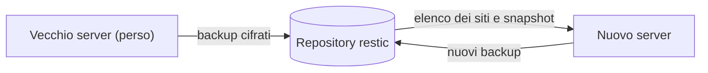

Quando perdi un server, i suoi siti tornano su un altro server CloudGround che legge lo stesso
repository di backup. Il nuovo pannello crea ogni sito com'era e ci ripristina per intero il suo
backup più recente.



## Installa CloudGround sul server nuovo {#install}

Segui [Installa CloudGround](/docs/tutorials/install). L'installer mette l'ultima release, che
ripristina i backup di ogni release precedente (vedi [Compatibilità nella 1.x](/docs/reference/compatibility#backups)).

Ripristina i siti prima di crearne di nuovi: un sito ripristinato tiene il suo ID solo se nessun sito
del nuovo pannello lo usa già (vedi [sotto](#same-names)).

## Collega lo stesso repository {#connect}

1. Apri **Impostazioni**, riquadro **Backup off-site (restic)**.
2. Scegli la stessa **Destinazione dei backup** del vecchio server, con lo stesso bucket e la stessa
   cartella, e le sue chiavi (vedi [Collega un repository di backup](/docs/data/connect-a-backup-repository)).
3. In **Password del repository** scrivi la password del vecchio repository. Non premere **Genera**:
   una password nuova non apre i backup.
4. Premi **Salva**. Il pannello prova repository e password insieme, e rifiuta di salvare se la
   password non apre il repository.

Un repository SFTP va raggiunto con la chiave del nuovo pannello: crea la chiave e aggiungila
sul server SFTP prima di salvare (vedi [SFTP](/docs/data/connect-a-backup-repository#destination)).

## Trova i siti da ripristinare {#list}

1. Apri **Siti** e premi **Ripristina da un altro server**. Lo stesso pulsante è nelle
   **Impostazioni**, accanto a **Sposta i backup**.
2. La pagina elenca i siti del repository che questo pannello non ha, da qualsiasi server:
   - **Sito**: il dominio;
   - **Server**: il nome del server che ha fatto i backup;
   - **Ultimo backup**: la data del più recente e quanti backup ci sono.

Un sito che il pannello ha già, come dominio o come alias, non compare. Per ripristinarlo da qui,
eliminalo prima.

Sotto un sito il cui ultimo backup è stato fatto prima della 1.0 compare *Backup precedente alla 1.0:
scegli tu il tipo* (vedi [sotto](#before-1-0)).

## Ripristina un sito {#restore}

1. Premi **Ripristina** sulla riga del sito.
2. Per un backup precedente alla 1.0, scegli il **Tipo** del sito e la versione **PHP** che aveva.
3. In **Scrivi `<dominio>` per confermare** scrivi il dominio e premi **Ripristina**.
4. Segui l'attività *Ripristino da un altro server*. Il sito compare subito nell'elenco dei siti.

Ripeti per ogni sito.

## Cosa torna {#what-comes-back}

Il nuovo pannello crea il sito dalla descrizione salvata in ogni backup dalla 1.0:

- dominio e alias;
- tipo, profilo della cache, versione PHP;
- cache di pagina e object cache;
- per un sito Node.js o Python, la versione del runtime e il comando di avvio.

Poi ripristina il backup per intero:

- tutta la cartella del sito: rilasci, `shared/` (configurazione e file caricati), chiavi SFTP e
  `logs/` (vedi [cosa c'è in un backup](/docs/data/back-up-a-site#contents));
- ogni database del backup, con lo stesso nome;
- gli utenti database, con la loro password e i loro privilegi.

Il connettore WordPress di un sito viene collegato a questo pannello. Alla fine il pannello svuota la
cache di pagina del sito, ne fa un backup su questo server e lo verifica con il ripristino di prova. Da
lì il sito ha i suoi backup qui.

### Gli stessi nomi e le stesse password {#same-names}

La configurazione dell'applicazione (`wp-config.php`, il `.env` di Laravel, il file di configurazione
di un sito PHP) nomina database, utente e password. Il sito ripristinato tiene quelli del backup,
quindi si collega al database senza modifiche.

Il sito tiene anche il suo ID, e con lui l'utente di sistema `cg-site-<id>` e i nomi `site_<id>`, se
nessun sito di questo pannello ha già quell'ID. Se l'ID è preso, il sito ne riceve uno nuovo e i nomi
`site_<id>` cambiano con lui:

- un sito WordPress o WooCommerce viene ricollegato da solo: il pannello riscrive i dati del database
  in `wp-config.php`;
- per gli altri tipi, il registro dell'attività dice quale database e quale utente mettere nella
  configurazione. La password la imposti tu, dalla [scheda Database](/docs/data/manage-databases#reset-password).

Un database in più il cui nome è già preso su questo server resta fuori, e così un utente database
che non si può creare: il registro dell'attività li nomina.

### Un backup precedente alla 1.0 {#before-1-0}

Un backup fatto prima della 1.0 non ha la descrizione del sito, quindi il pannello chiede il tipo e
la versione PHP. Il resto parte dai valori di un sito nuovo, alias compresi. Il sito prende un ID
nuovo e il database principale una password nuova, quindi vale quello che dice il paragrafo
precedente per i nomi che non si possono tenere. Gli altri utenti database non vengono ricreati.

## Cosa rifai tu {#what-to-redo}

- **DNS**: punta i record A o AAAA del dominio e degli alias al nuovo server.
- **Certificati**: se nelle **Impostazioni** c'è l'**Email per Let's Encrypt**, il ripristino chiede
  il certificato quando crea il sito. Se il DNS non punta ancora qui, l'attività scrive
  `Certificate pending (DNS may not point here yet)`: quando il DNS è a posto, emetti il certificato
  dalla scheda **SSL** (vedi [Domini e certificati](/docs/sites/domains-and-certificates#issue-the-certificate)).
  Un certificato tuo va caricato di nuovo.
- **Database su un server esterno**: non si ripristinano da qui. L'attività li nomina
  (`the database <nome> was on an external database server; it is not restored here`). Il loro dump è
  nel backup: ripristinalo a mano con restic.
- **Un sito fuori dalla cartella dei siti**: se sul vecchio server la cartella del sito non era
  `/srv/sites/<dominio>`, il ripristino fallisce con `the snapshot does not contain the site's files`.
  Il sito creato per il ripristino resta: [eliminalo](/docs/sites/delete-a-site) e ripristina i file a
  mano con restic.
- **Le altre impostazioni del sito** non sono nella descrizione e ripartono dai valori di un sito
  nuovo. Per esempio attività pianificate, redirect, routing, percorsi protetti, impostazioni PHP,
  limiti di risorse, controllo di uptime, accesso SFTP (spento) e pianificazione dei backup (ogni
  giorno, conservati 30 giorni).
- **Il pannello**: utenti, token API, funzioni, server di database esterni e le altre
  **Impostazioni** non sono nei backup dei siti. Rifalli sul nuovo pannello.

I backup del vecchio server restano nel repository. Il nuovo pannello non li tocca mai, nemmeno con la
conservazione: quando non servono più, toglili tu con restic.

## Con cgctl {#cli}

```bash
cgctl backup foreign
cgctl --wait backup import <snapshot> <dominio>
cgctl --wait backup import <snapshot> <dominio> --type laravel --php <versione>
```

- `backup foreign` elenca i siti del repository che questo pannello non ha, con `domain`, `hostname`
  (il server che ha fatto i backup), lo `snapshot` più recente e la sua data (`time`), quanti backup ci
  sono (`snapshots`) e se il backup ha la descrizione del sito (`manifest`).
- `backup import` ripristina lo snapshot. `<dominio>` è la conferma e deve essere quello del backup.
  `--type` e `--php` servono per un backup precedente alla 1.0. I tipi sono `wordpress`, `woocommerce`,
  `static`, `php`, `laravel`, `node` e `python`; la versione PHP deve essere installata sul server.

Entrambi accedono con email e password (`CLOUDGROUND_EMAIL`, `CLOUDGROUND_PASSWORD` e, con la 2FA,
`CLOUDGROUND_TOTP`): l'API non accetta un token per questo ripristino. Nell'API sono
`GET /api/backups/foreign` e `POST /api/backups/foreign/restore` con
`{"snapshot": "<snapshot>", "confirm": "<dominio>"}`, più `type` e `php_version` per un backup
precedente alla 1.0.

## Prossimo passo {#next}

[Domini e certificati](/docs/sites/domains-and-certificates), per far rispondere i siti dal nuovo
server.
