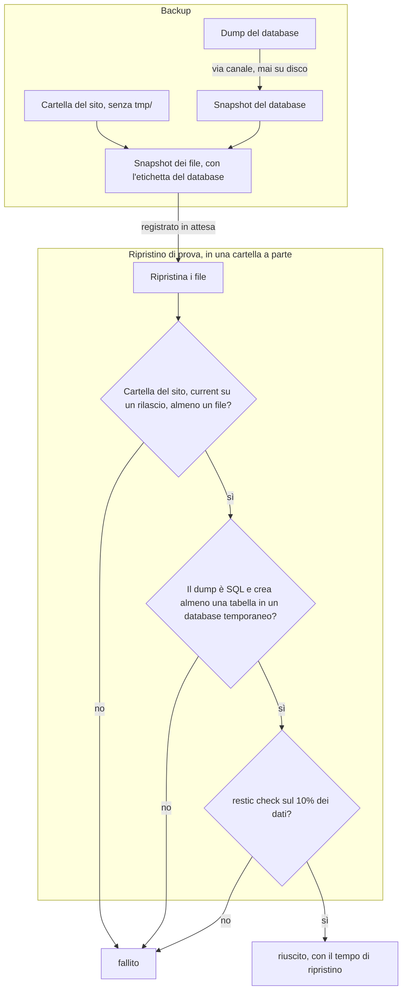

In CloudGround un backup conta solo dopo un ripristino di prova. La prova fa tutto quello che farebbe un
ripristino vero, tranne toccare il sito.

## Com'è fatto un backup {#anatomy}

I backup di tutti i siti vanno in un solo repository restic, fuori dal server, cifrati con la
password del repository. Un backup è fatto di due snapshot:

1. **il database**: `mariadb-dump` scrive in un canale che restic legge direttamente. Il dump non
   tocca mai il disco, e in particolare la cartella del sito, che appartiene all'utente del sito:
   lì potrebbe essere sostituito tra il dump e il backup;
2. **i file**: tutta la cartella del sito tranne `tmp/`. Lo snapshot dei file porta un'etichetta
   con l'identificativo dello snapshot del database, e il pannello registra lo snapshot dei file.

Se il dump fallisce, o anche un solo file non si legge, il backup fallisce e restic dimentica gli
snapshot parziali.

Un solo processo restic lavora su un repository alla volta, e un backup interrotto toglie il suo
blocco dal repository prima di uscire, così il backup successivo parte.

## Il ripristino di prova {#restore-test}

La prova ripristina lo snapshot in una cartella del server riservata all'agente e controlla gli
stessi requisiti di un ripristino vero: la cartella del sito, il collegamento `current` che punta
a un rilascio che esiste nello snapshot, almeno un file. Poi legge l'inizio del dump, lo importa
in un database temporaneo con lo stesso client isolato di un ripristino, conta le tabelle (per
WordPress serve la tabella delle opzioni) ed elimina il database temporaneo. Infine `restic check`
rilegge un 10% dei dati del repository. Il tempo fino all'importazione è la stima di quanto
durerebbe un ripristino.

Regole:

- un backup nasce *in attesa* e solo la prova lo porta a *riuscito* o *fallito*;
- la prova parte nello stesso lavoro del backup e arriva in fondo anche se il lavoro viene
  interrotto; a ogni avvio il pannello rifà la prova di ogni backup rimasto *in attesa*;
- la conservazione non toglie mai il backup più recente *riuscito*, né uno *in attesa*;
- il pannello non elimina quei due backup nemmeno su richiesta.

## Il ripristino vero {#restore}

Un ripristino comincia con uno **snapshot di sicurezza** del sito com'è adesso, verificato con
la stessa prova. Se la prova fallisce, il ripristino si ferma: il sito non è stato toccato.

Poi:

- i file ripristinati vengono preparati accanto alla cartella del sito, sullo stesso disco, e
  scambiati con quella attuale in una sola operazione del kernel, quindi non c'è un momento senza sito;
- con il database (modalità *Tutto* o *Solo il database*), ogni database scelto viene salvato, svuotato e ricreato dal dump, quindi le tabelle nate dopo lo snapshot
  spariscono; gli altri database del sito non vengono toccati;
- PHP del sito riparte (svuotando la cache del codice e degli oggetti), nginx ricarica;
- se il sito non riparte, file e database tornano com'erano.

Alla fine la cache di pagina viene svuotata, ma la sua cartella resta: senza
quella cartella il sito smetterebbe di usare la cache.

## Prima di una migrazione {#before-a-migration}

*Da v0.2.0.* L'importazione di una migrazione sostituisce i file caricati e le tabelle del sito,
e un archivio vecchio o sbagliato viene importato senza errori. Comincia quindi come un
ripristino: con uno snapshot di sicurezza di tipo `pre-migration`, verificato con il ripristino di
prova. Se la prova fallisce, l'importazione si ferma prima di cambiare il sito.

Il registro dell'attività nomina lo snapshot (`safety snapshot <id> retained`). Se l'importazione
fallisce, lo snapshot resta: ripristinandolo, il sito torna com'era prima della migrazione.

Senza un repository di backup configurato l'importazione parte lo stesso, perché un server appena
installato deve poter migrare il suo primo sito. L'attività lo dice prima di toccare
qualcosa: *No backup repository is configured: no safety snapshot is taken, and this import cannot be
undone*.

## Prossimo passo {#next}

[Esegui un ripristino di prova](/docs/data/run-a-restore-test) su uno snapshot.
