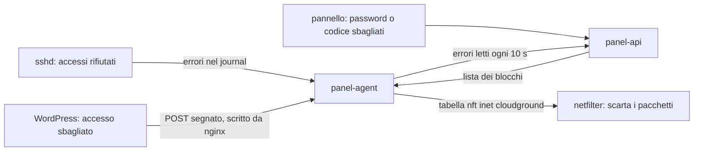

CloudGround ha due difese contro i visitatori indesiderati. La **lista dei
blocchi** riguarda tutto il server e scatta da sola quando un indirizzo sbaglia troppo l'accesso. Le
**regole per sito** riguardano un sito e le scrivi tu. Per usarle: [blocca gli indirizzi che sbagliano
l'accesso](/docs/access/block-addresses) e [rifiuta visitatori per indirizzo, user agent o
paese](/docs/access/refuse-visitors).

## La lista dei blocchi {#block-list}

Tre fonti dicono al pannello quanti accessi sono falliti, e da quale indirizzo:

- **SSH**: l'agent legge il journal di sshd e conta una riga solo se i campi affidabili del journal dicono
  che l'ha scritta sshd, perché un utente può scrivere nel journal righe che somigliano a quelle di sshd;
- **WordPress**: il connettore segna con un'intestazione una richiesta di accesso fallita, e nginx scrive
  l'indirizzo di quel `POST` su un socket che solo l'agent legge. Conta solo un `POST` che ha raggiunto
  il sito, mai un `GET` servito dalla cache, e un sito non può far contare errori contro un
  indirizzo che non gli ha scritto;
- **il pannello**: ogni password e ogni codice sbagliati.

Il pannello conta gli errori di un indirizzo in una finestra scorrevole. Un indirizzo IPv6 conta insieme a
tutta la sua /64, perché un singolo cliente di solito riceve un /64 intero. Superata la soglia, il
pannello salva il blocco e manda la lista all'agent, che la applica in una tabella netfilter del pannello
(`inet cloudground`). La rimanda ogni 10 minuti, perché un riavvio svuota netfilter.

**Perché netfilter.** Un pacchetto scartato non costa niente a sshd né a nginx, e una sola tabella copre
SSH, i siti e il pannello. Non dipende da ufw, che può essere spento. Il pacchetto `nftables`
è tra quelli dell'installer, e un [aggiornamento](/docs/server/update-cloudground) installa i pacchetti
nuovi che una release richiede. Se `nftables` manca, la pagina **Blocchi** dice che la lista non è
applicata.

**Perché non blocca te.** Il loopback, gli indirizzi del server e la lista dei sempre consentiti non
vengono mai bloccati. Un blocco a mano che contiene il tuo indirizzo, il server o un indirizzo consentito
è rifiutato. Dalla console del server, `cgctl blocklist unblock` resta sempre possibile.

Si aggiunge a [La protezione dell'accesso](/docs/explanation/sign-in-protection), che rallenta
i tentativi del pannello senza bloccare: il rallentamento protegge l'account, il blocco allontana
l'indirizzo.

## Le regole per sito {#site-rules}

Le regole di un sito diventano un file di configurazione di nginx solo suo: un elenco di indirizzi, i
prefissi dei paesi scelti e un'unica espressione per gli user agent, che insieme decidono una variabile.
Il virtual host del sito, sulla porta 443, risponde **403** quando la variabile è vera, nella fase di
nginx che viene prima della cache di pagina. Un sito senza regole non ha né il file né il controllo. Se nginx non accetta il file, il pannello non salva e annulla la modifica.

Le regole non toccano mai gli indirizzi del server e il loopback, così i controlli del pannello sul sito
continuano a funzionare, e lasciano aperta la porta 80 per i certificati.

**I paesi.** Il paese di un indirizzo viene dal database DB-IP *IP to Country Lite* (CC BY 4.0), che
l'agent scarica da solo e conserva sul server in `/var/lib/cloudground-agent/geo/`, rinnovato dopo 35
giorni. Gli intervalli diventano reti esatte, per IPv4 e IPv6, e l'attribuzione è in ogni file generato.
Il database sbaglia ogni tanto, quindi è un filtro e non una barriera.

**Lo user agent** lo dichiara il visitatore. Una regola sugli user agent allontana i crawler corretti, non
un attaccante.

## Prossimo passo {#next}

[Come funzionano i controlli di sicurezza](/docs/explanation/security-scans).
