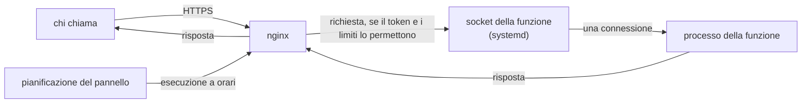

Una funzione è codice che esiste solo mentre risponde.

## Un processo per richiesta {#one-process-per-request}

Tra una richiesta e l'altra non gira niente. systemd tiene aperto il socket della funzione; quando
nginx ci porta una richiesta, systemd avvia un processo nuovo, che la legge, chiama il gestore, scrive
la risposta ed esce.

Ogni richiesta carica il codice da capo. Una funzione non ricorda niente tra una
chiamata e l'altra: variabili in memoria, connessioni aperte e file temporanei spariscono con il
processo. Quello che deve restare va scritto altrove, per esempio in un database. In cambio una
funzione ferma non occupa memoria né processore, e due chiamate non si influenzano.

## Chi la protegge da chi la chiama {#protection}

I controlli stanno in nginx, prima che si avvii un processo:

- il token, se la funzione lo chiede: senza quello giusto la risposta è 401 e non parte niente;
- i limiti per client e per funzione, che rispondono 429 e 503 oltre le soglie;
- il socket accetta al massimo 32 connessioni alla volta.

I valori sono nella tabella di [Funzioni: valori e limiti](/docs/reference/functions#limits). Il
controllo dell'origine per i browser (CORS) sta nello stesso posto, e il controllo preliminare non
chiede il token.

## Che cosa la separa dal resto {#isolation}

Ogni funzione gira con un utente di sistema suo, `cg-fn-<id>`, in una sandbox di systemd: vede il
suo codice in sola lettura e non vede i siti, le altre funzioni, la configurazione del server né i
log. Ha la rete, come un sito. Non può cambiare il suo rilascio né il link `current`: li possiede
root.

Memoria e tempo sono limiti di systemd su ogni processo: oltre la memoria impostata, senza swap,
o oltre il tempo massimo, il processo viene fermato. Tutte le funzioni insieme stanno in un gruppo
che non supera il 50% della memoria del server, come ogni sito ha il suo gruppo di risorse. Il
confine tra i siti è in [L'isolamento dei siti](/docs/explanation/site-isolation).

## Rilasci e dipendenze {#releases}

Un rilascio è una cartella con il codice e le sue dipendenze, installate dal server. `current` è un
link al rilascio attivo, e ogni processo parte da lì. Cambiare rilascio non riavvia niente,
e il rollback è un cambio di link che riporta anche le dipendenze di allora. Un'installazione che
fallisce non lascia un rilascio a metà: la funzione continua con quello di prima.

## Senza indirizzo, la funzione non si raggiunge {#no-address}

nginx conosce una funzione solo attraverso il dominio delle funzioni o un suo dominio. Un nome che
nessun blocco rivendica finisce nel server predefinito, che chiude la connessione. Una
funzione senza indirizzo non si raggiunge da Internet. **Prova** e le esecuzioni a orari passano da un
socket interno che solo root può aprire, e non chiedono il token.

## Prossimo passo {#next}

[Crea una funzione](/docs/functions/create-a-function).
