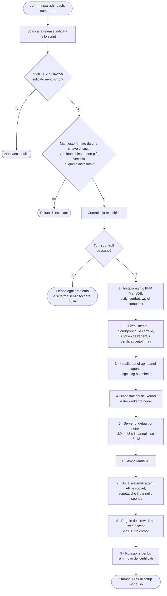

`install.sh` è un breve script di avvio: scarica una release da GitHub, la controlla e passa la mano
a `cgctl install`, che prepara un server Ubuntu vuoto e avvia il pannello. Tutto ciò che stampano i
programmi che lancia finisce in `/var/log/cloudground-install.log`; sul terminale vedi solo i nove
passi e la loro durata.

## I passi {#steps}

## Cosa controlla prima {#preflight}

Il controllo iniziale, prima dei passi, fa tutte le verifiche e riporta tutti i problemi insieme, così
correggi la macchina in un solo giro:

- Ubuntu 24.04 o 26.04 LTS, architettura amd64;
- almeno 900 MB di `MemTotal`: un server da 1 GB ne riporta un po' meno di 1024, e deve passare;
- almeno 10 GB liberi su `/`;
- porte 80 e 443 libere, perché nginx di CloudGround deve averle.

## I pacchetti {#packages}

PHP arriva in una versione diversa per sistema: 8.4 dal repository `ondrej/php` su Ubuntu 24.04,
8.5 dai pacchetti di Ubuntu su 26.04. Il servizio PHP-FPM della distribuzione viene spento: ogni
sito avrà il suo processo PHP-FPM, avviato dall'agent.

Redis non viene installato: la object cache dei siti usa APCu. Un server aggiornato da una versione
precedente tiene il suo Redis, spento.

Vengono installati solo i pacchetti che mancano. Rilanciare l'installer non aggiorna quelli già
presenti: è compito degli aggiornamenti di sicurezza del sistema o del tuo `apt upgrade`.

restic 0.19.1, wp-cli 2.12.0 e composer 2.10.3 sono scaricati in quelle versioni e installati solo se
il loro SHA-256 corrisponde a quello scritto nell'installer.

## I binari {#binaries}

Lo script indica una release e lo SHA-256 del `cgctl` di quella release. Scarica la release da GitHub
Releases, mai dall'indirizzo che ha servito lo script, e lancia `cgctl` solo se ha quell'hash. Poi
`cgctl` installa i binari solo se:

- il manifesto `SHA256SUMS` è firmato da una chiave delle release compilata in `cgctl` (con
  `CLOUDGROUND_RELEASE_PUBKEY`, da quella chiave, che deve essere anche una di quelle);
- il manifesto nomina la versione che lo script ha chiesto;
- la versione non è più vecchia di quella già installata, né della più recente a cui il pannello si
  è aggiornato;
- ogni binario corrisponde al suo hash nel manifesto.

Le unità systemd viaggiano dentro `cgctl`, quindi un `cgctl` verificato rende verificate anche loro.

## La fiducia {#trust}

Una volta che lanci lo script autentico, l'indirizzo che lo ha servito non ha più voce: non ha né i
file che l'hash dello script indica né la chiave di firma. Ma quell'indirizzo potrebbe servire uno
script diverso, e uno script decide tutto. Per non doverti fidare, scarica lo script di una release
precisa e controllalo con il manifesto firmato e la chiave delle release pubblicata in questa
documentazione: [verifica l'installer](/docs/server/verify-the-installer).

Dopo l'installazione, gli aggiornamenti del pannello controllano le release con le chiavi compilate
nei binari installati.

## Le scelte sul server {#server-choices}

- **Kernel e nginx.** Code di accettazione più lunghe e più file aperti, perché un picco non faccia
  scartare connessioni prima che un worker sia occupato. `worker_connections` sale a 4096; se nginx
  rifiuta la configurazione modificata, l'installer rimette l'originale.
- **Server di default.** Su :80 e :443 un nome sconosciuto non riceve nulla (`444`), tranne le
  verifiche dei certificati. Su :8443 risponde il pannello, con un certificato autofirmato suo che
  resta anche dopo aver dato un dominio al pannello: puoi sempre raggiungerlo per IP.
- **MariaDB.** L'installer lo avvia soltanto; la sua configurazione la calcola l'agent in base a
  memoria e CPU del server.
- **Firewall.** L'installer non accende mai ufw: molti server stanno dietro il firewall del loro
  provider, e uno script che accende ufw può chiuderti fuori. Se ufw è già attivo, apre le porte su
  cui ascolta sshd (quelle che riporta `sshd -T`, la 22 se non ne riporta nessuna), 80, 443, 443/udp e
  8443. Se ufw è installato ma spento, non cambia nulla e alla fine stampa i comandi che lo accendono
  con quelle porte aperte (vedi [firewall](/docs/access/firewall#enable)).
- **SFTP.** Gli utenti di sistema dei siti (`cg-site-*`) entrano solo in SFTP, chiusi nella
  cartella del sito. La [shell del sito](/docs/access/site-shell) usa un accesso a parte.
- **Log.** I log dei siti ruotano ogni giorno, o a 1 GB, e se ne tengono 14.

## Rilanciarlo {#rerun}

Ogni passo prima guarda la macchina e cambia solo ciò che è diverso. Così l'installer della release
già installata ripara il server: ciò che corrisponde resta com'è, e i servizi ripartono solo quando è
cambiato qualcosa che leggono. `cgctl doctor` fa gli stessi controlli e dice cosa è diverso senza
cambiare nulla.

L'installer di un'altra release si rifiuta di girare sopra un pannello installato e indica
`cgctl update --to <release>`: l'installer non ha snapshot né rollback, un aggiornamento li ha
entrambi (vedi [aggiorna CloudGround](/docs/server/update-cloudground)).

## Prossimo passo {#next}

Per provarlo su un server, segui il tutorial [Installa CloudGround](/docs/tutorials/install).
