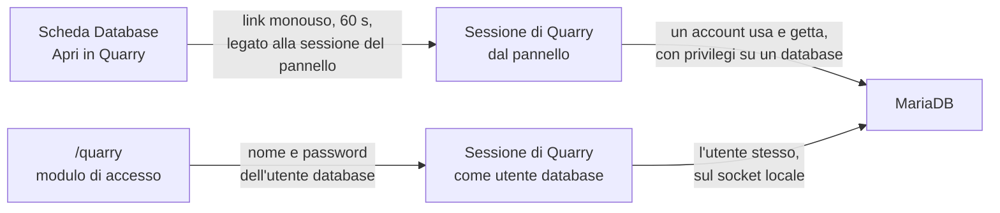

Quarry è il gestore di database di CloudGround. È integrato nel pannello e risponde sul suo indirizzo
in `/quarry`, ma è un servizio a sé: una sessione di Quarry non è una sessione del pannello. Una
sessione del pannello o un token API non raggiungono nessuna route di Quarry, e una sessione di Quarry
non raggiunge nessuna route del pannello. I passi sono in [Usa Quarry](/docs/data/use-quarry).

## Due ingressi {#two-ways-in}

**Dal pannello.** **Apri in Quarry** chiede al pannello un link che funziona una volta, per 60
secondi, e solo insieme alla sessione del pannello che l'ha chiesto. Il link porta il suo token dopo un
`#`, che un browser non manda mai a un server né mette in un `Referer`. Una sessione così vive quanto
la sessione del pannello che c'è dietro, e controlla a ogni richiesta che il tuo account raggiunga
ancora il sito. Le sue istruzioni girano con un account del database usa e getta, con privilegi solo su
quel database, e solo in lettura per un account del pannello in sola lettura, che vede le tabelle e la
loro struttura e nient'altro. Un token API non può aprire Quarry: può farlo solo una sessione del
pannello aperta da un browser.

**Con un utente database.** Chi non ha un account del pannello, uno sviluppatore o un'agenzia, accede
con nome e password di un utente database creato dal pannello. L'agent si collega a MariaDB come
quell'utente, sul socket locale del server, e controlla che il server l'abbia preso esattamente per
quell'utente. Non accede mai come `root`, che su questo server non ha bisogno di password sul socket,
né con gli account del server. La password resta nella memoria dell'agent, cifrata, per la durata
della sessione: non viene mai scritta su disco, nel database del pannello o in un log.

## Decide MariaDB {#mariadb-decides}

Quarry non legge il tuo SQL per indovinare cosa può fare. Ogni istruzione gira con un account che
MariaDB stessa limita: l'account usa e getta ha privilegi su un database, uno in sola lettura solo
`SELECT, SHOW VIEW`; un utente che ha fatto l'accesso ha esattamente i privilegi che gli hai dato
nella scheda **Database**. Una scrittura che l'account non può fare fallisce con l'errore del server.
Per questo lo stesso Quarry si può dare a qualcuno a cui affidi una sola tabella e a un amministratore:
il confine sono i privilegi, che fa rispettare il server del database, non l'interfaccia.

Ogni richiesta apre la sua connessione e la chiude alla fine. Nulla dura da una richiesta all'altra:
non una transazione, non un `LOCK TABLES`, non una variabile di sessione.

## Sessioni {#sessions}

Le sessioni di Quarry vivono solo nella memoria del pannello. Una sessione finisce dopo 30 minuti
senza uso e 12 ore dopo l'inizio, all'uscita, e appena se ne va ciò su cui si regge: il sito, la
sessione del pannello che l'ha aperta, o la password dell'utente database. Un riavvio del pannello le
chiude tutte. Vite brevi evitano che una scheda dimenticata resti una porta su un database.

## Simula {#simulate}

Simula esegue una scrittura in una transazione e la annulla sempre, per mostrare quante righe
cambierebbe. La promessa è *non resta nulla*. Quasi tutto ciò che rifiuta serve a mantenerla:

- **Istruzioni che fanno commit da sole.** In MariaDB, `CREATE`, `ALTER`, `DROP`, `TRUNCATE`,
  `RENAME`, `LOCK` e simili chiudono la transazione aperta: non resterebbe nulla da annullare.
- **Tabelle che non sono InnoDB.** Le tabelle MyISAM, Aria e MEMORY non partecipano alle
  transazioni: una modifica resta, annullamento o no.
- **Trigger, viste, funzioni memorizzate e caricabili.** Un trigger gira come chi l'ha definito e può
  scrivere ovunque; una vista o una funzione possono raggiungere tabelle che l'istruzione non nomina.
  Quarry non può seguirle, quindi le rifiuta, ed elenca le funzioni predefinite che accetta invece di
  quelle che rifiuta: un trucco a cui nessuno ha pensato è rifiutato in partenza.
- **Funzioni che aspettano, bloccano o contano.** `SLEEP`, `BENCHMARK` e le funzioni di lock
  terrebbero occupata la connessione; una funzione di sequenza o `LAST_INSERT_ID` fanno avanzare un
  contatore che nessun annullamento riporta indietro.
- **Letture con blocco.** `FOR UPDATE` e simili bloccano righe che l'istruzione non cambia, righe che
  il sito in produzione potrebbe aspettare.
- **Un altro modo di leggere le stringhe.** Con `ANSI_QUOTES` o `NO_BACKSLASH_ESCAPES` nel `sql_mode`
  della sessione, il server legge virgolette e barre rovesciate in modo diverso dai controlli: un nome
  potrebbe passare per una stringa. Quarry controlla ogni istruzione in ciascuna lettura, e rifiuta
  una sessione così.

Il sito continua a rispondere mentre una simulazione gira, sulle stesse tabelle. Per questo una
simulazione aspetta al massimo 5 secondi una riga bloccata dal sito (il valore predefinito del server
è 50), e l'intera esecuzione ha 60 secondi: mentre aspetta tiene le righe che ha già bloccato, e il
sito aspetterebbe su di esse.

Cosa lascia comunque una scrittura annullata: un contatore `AUTO_INCREMENT`, e una sequenza da cui una
colonna prende il suo valore predefinito, possono essere andati avanti. Le righe non cambiano.

## Import senza punto di ripristino {#import}

Aperto dal pannello, un import `.sql` salva prima il database e lo rimette al suo posto se l'import
fallisce. Fare quella copia e rimetterla al suo posto richiede privilegi che un utente database può non
avere, quindi l'import di un utente che ha fatto l'accesso non ha punto di ripristino: gira come
l'utente, un'istruzione alla volta, e un errore si ferma dove il server ha rifiutato, tenendo ciò che è
stato eseguito prima. Il messaggio lo dice.

## File {#files}

Esportazioni e caricamenti stanno nella cartella del sito, `shared/exports/` e `shared/imports/`, che
tutte le sessioni del sito condividono. Un utente database che ha fatto l'accesso vede, scarica e
importa solo i file creati nella sua sessione: l'esportazione di un altro utente può contenere tabelle
che questo non può leggere, e il caricamento di un altro utente, importato con i privilegi di questo,
potrebbe cambiare ciò che non doveva mai toccare.

## Registro attività {#audit}

Ogni scrittura finisce nel **Registro attività**, con la tabella e la chiave primaria, mai il
contenuto delle righe; un'istruzione viene registrata come prima parola, numero di parole e
un'impronta, perché le istruzioni possono contenere segreti. Una simulazione viene registrata come una
scrittura. Anche gli accessi e gli accessi rifiutati vengono registrati.

## Prossimo passo {#next}

Come le password sbagliate ripetute vengono rallentate senza bloccare nessuno:
[la protezione dell'accesso](/docs/explanation/sign-in-protection).
