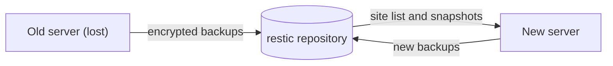

When a server is lost, its sites come back on another CloudGround server that reads the same backup
repository. The new panel recreates each site as it was and restores its newest backup in full.



## Install CloudGround on the new server {#install}

Follow [Install CloudGround](/docs/tutorials/install). The installer sets up the latest release, which
restores backups made by every earlier release (see [Compatibility in 1.x](/docs/reference/compatibility#backups)).

Restore the sites before you create any new ones: a restored site keeps its ID only if no site on the
new panel already has it (see [below](#same-names)).

## Connect the same repository {#connect}

1. Open **Settings** and go to the **Off-site backups (restic)** panel.
2. Choose the same **Backup destination** as on the old server, with the same bucket and folder, and
   its keys (see [Connect a backup repository](/docs/data/connect-a-backup-repository)).
3. Under **Repository password**, enter the old repository's password. Don't click **Generate**: a new
   password can't open the existing backups.
4. Click **Save**. The panel tests the repository and password together, and refuses to save if the
   password doesn't open the repository.

An SFTP repository is reached with the new panel's own key: make the key and add it on the SFTP
server before you save (see [SFTP](/docs/data/connect-a-backup-repository#destination)).

## Find the sites to restore {#list}

1. Open **Sites** and click **Restore from another server**. The same button is in **Settings**, next
   to **Move backups**.
2. The page lists the sites in the repository that this panel doesn't have, from any server:
   - **Site**: the domain;
   - **Server**: the name of the server that took the backups;
   - **Last backup**: when the newest one was taken, and how many backups there are.

A site this panel already has, as a domain or an alias, isn't listed. To restore it from here, delete
it first.

A site whose newest backup was taken before 1.0 shows *Backup from before 1.0: you choose the type*
(see [below](#before-1-0)).

## Restore a site {#restore}

1. Click **Restore** on the site's row.
2. For a backup from before 1.0, choose the site's **Type** and the **PHP** version it ran.
3. Under **Type `<domain>` to confirm**, type the domain and click **Restore**.
4. Follow the *Restore from another server* task. The site shows up in the site list straight away.

Repeat for each site.

## What comes back {#what-comes-back}

Since 1.0 every backup carries a description of its site, and the new panel creates the site from it:

- domain and aliases;
- type, cache profile and PHP version;
- page cache and object cache;
- for a Node.js or Python site, the runtime version and the start command.

It then restores the whole backup:

- the entire site folder: releases, `shared/` (configuration and uploads), SFTP keys and `logs/` (see
  [what a backup holds](/docs/data/back-up-a-site#contents));
- every database in the backup, under the same name;
- the database users, with their passwords and privileges.

A WordPress site's connector is linked to this panel. Finally the panel purges the site's page cache, backs
the site up on this server and runs a restore test on that backup. From then on the site has its own
backups here.

### Same names, same passwords {#same-names}

An application's configuration (`wp-config.php`, a Laravel `.env`, a PHP site's config file) names its
database, user and password. The restored site keeps the ones from the backup, so it connects to its
database without any changes.

The site also keeps its ID, and with it the system user `cg-site-<id>` and the `site_<id>` names, as
long as no site on this panel already has that ID. If the ID is taken, the site gets a new one and the
`site_<id>` names change with it:

- a WordPress or WooCommerce site is reconnected automatically: the panel rewrites the database
  settings in `wp-config.php`;
- for any other type, the task log says which database and user to put in the configuration. Set the
  password yourself from the [Database tab](/docs/data/manage-databases#reset-password).

An extra database whose name is already taken on this server is left out, and so is a database user
that can't be created. The task log names them.

### A backup from before 1.0 {#before-1-0}

Backups taken before 1.0 have no description of the site, so the panel asks for its type and PHP
version. Everything else starts from a new site's defaults, aliases included. The site gets a new ID
and its main database a new password, so the rules above for names that can't be kept apply. Other
database users aren't recreated.

## What you redo yourself {#what-to-redo}

- **DNS**: point the A or AAAA records of the domain and its aliases at the new server.
- **Certificates**: if **Let's Encrypt email** is set in **Settings**, the restore requests a
  certificate when it creates the site. If DNS doesn't point here yet, the task logs
  `Certificate pending (DNS may not point here yet)`: once DNS is right, issue the certificate from the
  **SSL** tab (see [Domains and certificates](/docs/sites/domains-and-certificates#issue-the-certificate)).
  Upload your own certificate again if the site used one.
- **Databases on an external server** aren't restored from here. The task names them
  (`the database <name> was on an external database server; it is not restored here`). Their dump is in
  the backup: restore it by hand with restic.
- **A site outside the sites folder**: if the site's folder on the old server wasn't
  `/srv/sites/<domain>`, the restore fails with `the snapshot does not contain the site's files`. The
  site created for the restore stays: [delete it](/docs/sites/delete-a-site) and restore the files by
  hand with restic.
- **Other site settings** aren't in the description and start from a new site's defaults. For
  example: scheduled tasks, redirects, routing, protected paths, PHP settings, resource limits, the
  uptime check, SFTP access (off) and the backup schedule (daily, kept for 30 days).
- **The panel itself**: users, API tokens, functions, external database servers and the rest of
  **Settings** aren't part of site backups. Set them up again on the new panel.

The old server's backups stay in the repository. The new panel never touches them, retention
included: remove them with restic once you no longer need them.

## Restore with cgctl {#cli}

```bash
cgctl backup foreign
cgctl --wait backup import <snapshot> <domain>
cgctl --wait backup import <snapshot> <domain> --type laravel --php <version>
```

- `backup foreign` lists the sites in the repository that this panel doesn't have, with `domain`,
  `hostname` (the server that took the backups), the newest `snapshot` and its `time`, how many
  `snapshots` there are, and whether the backup carries the site's description (`manifest`).
- `backup import` restores the snapshot. `<domain>` is the confirmation and must match the backup's.
  `--type` and `--php` are for backups from before 1.0. The types are `wordpress`, `woocommerce`,
  `static`, `php`, `laravel`, `node` and `python`; the PHP version must be installed on the server.

Both commands sign in with email and password (`CLOUDGROUND_EMAIL`, `CLOUDGROUND_PASSWORD` and, with
2FA, `CLOUDGROUND_TOTP`): the API doesn't accept a token for this restore. In the API they are
`GET /api/backups/foreign` and `POST /api/backups/foreign/restore` with
`{"snapshot": "<snapshot>", "confirm": "<domain>"}`, plus `type` and `php_version` for a backup from
before 1.0.

## Next step {#next}

[Domains and certificates](/docs/sites/domains-and-certificates), so the sites answer from the new
server.
