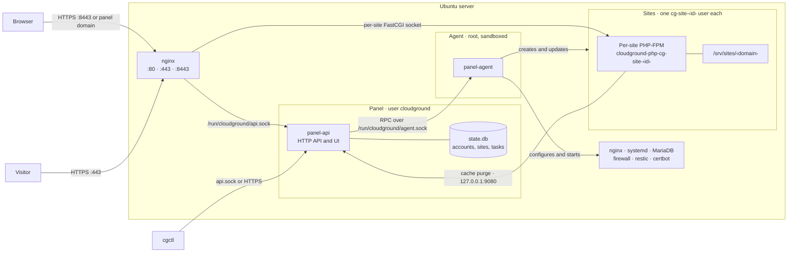

CloudGround is split into two processes. One faces the outside world and has no privileges. The
other has root privileges and never faces the outside world. Sites run separately, each under its
own system user.

## Overview {#diagram}

## The panel {#the-panel}

`panel-api` serves the web UI and the HTTP API. It runs as the `cloudground` user with no
capabilities, inside a systemd sandbox that only lets it write to `/var/lib/cloudground`. That is
where it keeps `state.db`, the database that holds accounts, sites, tasks and the audit log.
Secrets in the database are encrypted with a key stored in `secret.key`.

The panel does not listen on a public TCP port. systemd passes it the Unix socket
`/run/cloudground/api.sock`, and only nginx can open that socket. This makes the proxy the API's
only client, and the proxy decides which client address a request came from. The WordPress
connector on each site uses a second listener: plain HTTP, bound to `127.0.0.1:9080` only, and
limited to two calls: cache purge and health check.

Every long-running operation (creating a site, taking a backup, deploying a release) becomes a
**task** in a queue stored in the database. Tasks survive a panel restart, and the browser shows
their progress live.

## The agent {#the-agent}

`panel-agent` does everything that needs root: system users, nginx and PHP config files,
databases, certificates, the firewall and backups. It listens only on the socket
`/run/cloudground/agent.sock` and accepts a connection only if both of these hold:

- the kernel reports that the connecting process is root or the panel user;
- the request carries the shared token from `/etc/cloudground/agent.token`.

The agent is sandboxed too. It can write only to the paths its job requires, and every program it
launches inherits the same sandbox. It talks to the system through typed adapters: systemd over
D-Bus, nginx with `nginx -t` before every reload, restic through its exit codes. It always builds
argument lists, never shell strings, and never puts a secret on a command line.

*Since v0.3.0.* The agent's unit has a memory limit (768 MB soft threshold, 1 GB hard cap). This is
a second guard, on top of the caps on output from the programs it runs. Heavy tools (`restic`,
`mariadb-dump`, the `mariadb` client and `certbot`) do not run in the agent's process group. If
they did, a large backup would hit the agent's limit and get cut off. Instead, each one gets its
own transient unit in `cg-helper.slice`, with the same sandbox as the agent. Its environment,
including restic's secrets, is passed on standard input, never on the command line or in unit
properties. If a backup runs out of memory, only the backup fails and the agent keeps running. At
startup the agent also checks that the system packages the release needs are installed (see
[Update CloudGround](/docs/server/update-cloudground#packages)).

## The sites {#the-sites}

Each site has its own system user `cg-site-<id>` and its own directory under
`/srv/sites/<domain>`. Sites that run PHP also get their own PHP-FPM process, with a private
OPcache and APCu. All of a site's processes (PHP, scheduled tasks, wp-cli, the shell) run in the
same systemd slice and the same sandbox, which hides other sites and the server configuration.
[Site isolation](./site-isolation.mdx) explains how this works.

## Design rationale {#why}

- **A panel bug does not give root.** The part that faces the browser has no privileges. To change
  anything on the system it has to ask the agent, which validates every request and every site it
  names.
- **Sites cannot see each other.** PHP caches, files and processes are per site, so a compromised
  plugin stays confined to its own site.
- **The server stays consistent.** The agent tests a configuration before loading it and reverts it
  if nginx rejects it. Every five minutes the panel compares the files it manages with what it last
  wrote, and flags outside changes on the dashboard.

## Next step {#next}

To follow a visit from the browser all the way to PHP, read [How a request is
served](./request-path.mdx).
