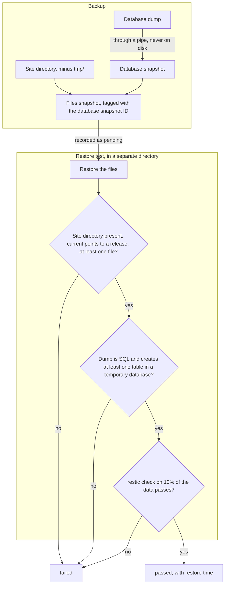

A backup counts only after a test restore. The test does everything a real restore does, except touch the site.

## What a backup contains {#anatomy}

Backups for all sites go to a single restic repository off the server, encrypted with the
repository password. Each backup is made of several snapshots:

1. **Databases.** One snapshot per database of the site, holding its dump. `mariadb-dump` writes
   to a pipe that restic reads directly. The dump never lands on disk. In particular, it never
   lands in the site directory, which the site user owns and where the file could be swapped out
   between the dump and the backup.
2. **The site's description** (*since v1.0.0*). A file called `cloudground-site.json` (see
   [below](#site-description)).
3. **Files.** The whole site directory except `tmp/`. The files snapshot is tagged with the ID of
   each database snapshot and of the description, and the panel records the files snapshot.

If a dump fails, or a single file cannot be read, the whole backup fails and restic forgets the
partial snapshots. Deleting a backup, or retention, removes all its parts together.

### The site's description {#site-description}

It holds what another server needs to recreate the site before restoring it:

- the CloudGround release that took the backup;
- the site's ID, domain, aliases, type, cache profile and PHP version;
- for a Node.js or Python site, the runtime version and the start command;
- the page cache and object cache settings;
- the site's directory;
- each database in the backup, with its engine (MariaDB or PostgreSQL), whether it's the main one
  and whether it lives on an external server;
- the site's database users on this server, with their passwords and privileges.

The passwords are there on purpose. An application's configuration (`wp-config.php`, a `.env` file)
holds its database name, user and password. A site
[restored on another server](/docs/data/restore-on-a-new-server) gets the same users with the same
passwords, so it connects to its database without changes. The description is encrypted with the
repository key like every other snapshot, and the backup already holds the databases' data and, for
WordPress, `wp-config.php`.

The restore test also checks that the description can be read. Backups taken before 1.0 have none
and are tested as before.

Only one restic process works on a repository at a time. If a backup is interrupted, it releases
its repository lock before exiting so the next backup can run.

## The restore test {#restore-test}

The test restores the snapshot into an agent-only directory on the server and checks the same
things a real restore needs: the site directory exists, the `current` link points to a release
that is in the snapshot, and there is at least one file. Next it reads the start of the dump,
imports it into a temporary database using the same sandboxed client a restore uses, and counts
the tables (for WordPress, the options table must be present). Then it drops the temporary
database. Finally, `restic check` re-reads 10% of the repository data. The time taken up to the
end of the import is the estimate of how long a real restore would take.

Rules:

- every backup starts as *pending*, and only the test can mark it *passed* or *failed*;
- the test runs in the same job as the backup and finishes even if the job is interrupted; each
  time the panel starts, it re-tests any backup still *pending*;
- retention never removes the most recent *passed* backup, or any *pending* one;
- the panel refuses to delete those backups even if you ask it to.

## A real restore {#restore}

A restore starts by taking a **safety snapshot** of the site as it is now, and checks it with the
same restore test. If that test fails, the restore stops and the site is left untouched.

After that:

- the restored files are staged next to the site directory, on the same disk, and swapped in with
  a single kernel operation, so the site is never missing;
- if the restore includes the database (mode *Everything (files and database)* or *Database
  only*), each selected database is saved, emptied and rebuilt from the dump, so tables created
  after the snapshot do not survive; the site's other databases are left alone;
- the site's PHP restarts (clearing the opcode and object caches) and nginx reloads;
- if the site does not come back up, files and databases are put back the way they were.

Finally the page cache is emptied. Its directory stays, because without it
the site would stop caching.

## Before a migration {#before-a-migration}

*Since v0.2.0.* A migration import replaces the site's uploads and database tables, and an
old or wrong archive imports without any error. An import therefore starts like a restore:
with a `pre-migration` safety snapshot, checked by the restore test. If the test fails, the import
stops before the site changes.

The task log names the snapshot (`safety snapshot <id> retained`). If the import fails, the
snapshot is kept, and restoring it puts the site back to how it was before the migration.

If no backup repository is configured, the import still runs, because a freshly installed server
has to be able to migrate its first site. The task warns you before touching
anything: *No backup repository is configured: no safety snapshot is taken, and this import cannot
be undone*.

## Next step {#next}

[Run a restore test](/docs/data/run-a-restore-test) on a snapshot.
