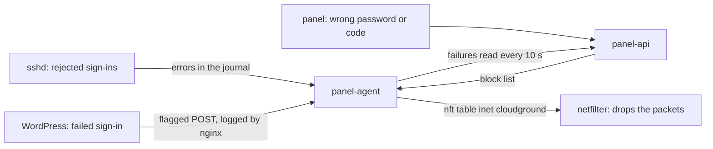

CloudGround has two separate defences against unwanted traffic. The **block list** applies to the
whole server and kicks in automatically when an address fails to sign in too many times.
**Per-site rules** apply to one site, and you write them yourself. For the how-to guides, see
[Block addresses that keep failing to sign in](/docs/access/block-addresses) and [Refuse visitors
by address, user agent or country](/docs/access/refuse-visitors).

## The block list {#block-list}

The panel learns about failed sign-ins, and the addresses behind them, from three sources:

- **SSH.** The agent reads sshd's journal. It only counts a line if the journal's trusted fields
  show that sshd wrote it, because any user can write lines into the journal that look like
  sshd's.
- **WordPress.** The connector flags a failed sign-in request with a header, and nginx writes the
  address behind that `POST` to a socket that only the agent reads. Only a `POST` that actually
  reached the site counts, never a `GET` served from cache. A site cannot make failures count
  against an address that never sent it a request.
- **The panel.** Every wrong password and every wrong code.

The panel counts failures per address over a sliding window. An IPv6 address is counted together
with its whole /64, because one customer usually gets an entire /64. Once an address crosses the
threshold, the panel records the block and sends the list to the agent. The agent applies it in a
netfilter table owned by the panel (`inet cloudground`) and re-sends it every 10 minutes, because a
reboot clears netfilter.

**Why netfilter.** A dropped packet costs sshd and nginx nothing, and a single table covers SSH,
the sites and the panel. It does not rely on ufw, which may be turned off. This is why `nftables`
is one of the packages the installer sets up, and why an [update](/docs/server/update-cloudground)
installs any new packages a release needs. If `nftables` is missing, the **Blocking** page tells
you the list is not being enforced.

**Why it will not lock you out.** Loopback, the server's own addresses and the **Always allowed**
list are never blocked. A manual block that covers your own address, the server or an always
allowed address is rejected. From the server console, `cgctl blocklist unblock` always works.

This defence works alongside [sign-in protection](/docs/explanation/sign-in-protection), which
slows down panel sign-in attempts without blocking anyone. Slowing down protects the account;
blocking keeps the address away.

## Per-site rules {#site-rules}

A site's rules are compiled into an nginx config file of its own: a list of addresses, the address
prefixes of the selected countries and one combined expression for user agents. Together they set
a single variable. When that variable is true, the site's virtual host on port 443 returns
**403**, in the nginx phase that runs before the page cache. A site with no rules has neither the
file nor the check, so it pays no cost. If nginx rejects the file, the panel does not save the
rules and reverts the change.

The rules never apply to the server's own addresses or loopback, so the panel's own checks against
the site keep working. They also leave port 80 open for certificate issuance.

**Countries.** An address's country comes from the DB-IP *IP to Country Lite* database (CC BY
4.0). The agent downloads it automatically, stores it on the server in
`/var/lib/cloudground-agent/geo/` and refreshes it after 35 days. The ranges are converted into
exact IPv4 and IPv6 networks, and every generated file carries the attribution. The database is
sometimes wrong, so treat country rules as a filter, not a wall.

**User agents** are whatever the visitor claims. A user agent rule keeps well-behaved crawlers
away, not attackers.

## Next step {#next}

[How security checks work](/docs/explanation/security-scans).
