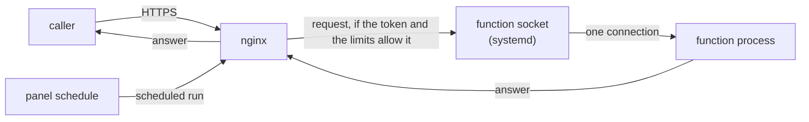

A function is code that exists only while it answers.

## One process per request {#one-process-per-request}

Nothing runs between requests. systemd keeps the function's socket open; when nginx brings it a
request, systemd starts a fresh process, which reads the request, calls the handler, writes the answer
and exits.

Every request loads the code from scratch. A function remembers nothing between
calls: variables in memory, open connections and temporary files vanish with the process. Anything that
has to last goes somewhere else, such as a database. In return an idle function takes no memory and no
processor time, and two calls never affect each other.

## What shields it from its callers {#protection}

The checks run in nginx, before a process exists:

- the token, if the function asks for one: without the right one the answer is a 401 and nothing starts;
- the limits per client and per function, which answer 429 and 503 past their thresholds;
- the socket takes 32 connections at a time at most.

The figures are in the table in [Functions: values and limits](/docs/reference/functions#limits).
The origin check for browsers (CORS) lives in the same place, and the preflight request doesn't ask for
the token.

## What keeps it apart from the rest {#isolation}

Each function runs as a system user of its own, `cg-fn-<id>`, in a systemd sandbox: it sees its own
code, read-only, and it doesn't see the sites, the other functions, the server's configuration or its
logs. It has network access, like a site. It can't change its own release or the `current` link:
root owns them.

Memory and time are systemd limits on each process: past the configured memory, with no swap, or past
the timeout, the process is stopped. All the functions together sit in one group that can't use more
than 50% of the server's memory, the way each site has a resource group of its own. The boundary
between sites is in [Site isolation](/docs/explanation/site-isolation).

## Releases and dependencies {#releases}

A release is a folder holding the code and its dependencies, which the server installs. `current` is a
link to the live release, and every process starts from there. Switching releases restarts
nothing, and a rollback is a change of link that also brings back the dependencies of that release. An
install that fails never leaves a half-made release: the function carries on with the previous one.

## With no address, the function can't be reached {#no-address}

nginx knows a function only through the functions domain or one of its own domains. A name no server
block claims lands in the default server, which closes the connection. A function with no
address can't be reached from the Internet. **Test** and scheduled runs go through an internal socket
that only root can open, and don't ask for the token.

## Next step {#next}

[Create a function](/docs/functions/create-a-function).
