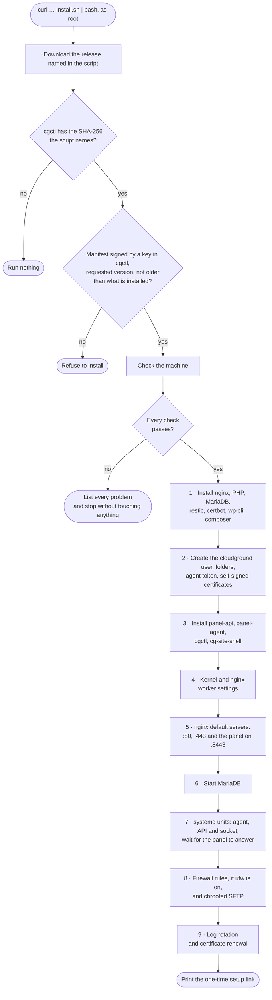

`install.sh` is a short bootstrap: it downloads one release from GitHub, checks it, and hands over
to `cgctl install`, which prepares an empty Ubuntu server and starts the panel. Everything the
programs it runs print goes to `/var/log/cloudground-install.log`; on the terminal you see only the
nine steps and how long each took.

## The steps {#steps}

## What it checks first {#preflight}

The initial check, before the steps, runs every test and reports every problem together, so you fix
the machine in one pass:

- Ubuntu 24.04 or 26.04 LTS, amd64 architecture;
- at least 900 MB of `MemTotal`: a 1 GB server reports a little under 1024, and must pass;
- at least 10 GB free on `/`;
- ports 80 and 443 free, because CloudGround's nginx must own them.

## The packages {#packages}

PHP comes in a different version per system: 8.4 from the `ondrej/php` repository on Ubuntu 24.04,
8.5 from Ubuntu's own packages on 26.04. The distribution's PHP-FPM service is switched off: each
site gets its own PHP-FPM process, started by the agent.

Redis is not installed: the sites' object cache uses APCu. A server upgraded from an earlier version
keeps its Redis, switched off.

Only missing packages are installed. Running the installer again does not upgrade the ones already
there: that is the job of the system's own security updates or of your `apt upgrade`.

restic 0.19.1, wp-cli 2.12.0 and composer 2.10.3 are downloaded at those versions and installed only
if their SHA-256 matches the one written in the installer.

## The binaries {#binaries}

The script names one release and the SHA-256 of that release's `cgctl`. It downloads the release
from GitHub Releases, never from the address that served the script, and runs `cgctl` only if it has
that hash. `cgctl` then installs the binaries only when:

- the `SHA256SUMS` manifest is signed by a release key compiled into `cgctl` (with
  `CLOUDGROUND_RELEASE_PUBKEY`, by that key, which must also be one of them);
- the manifest names the version the script asked for;
- the version is not older than the one already installed, nor than the newest the panel has updated
  itself to;
- every binary matches its hash in the manifest.

The systemd units travel inside `cgctl`, so a verified `cgctl` makes them verified too.

## Trust {#trust}

Once you run the genuine script, the address that served it has no further say: it holds neither the
files the script's hash names nor the signing key. But that address could serve a different script,
and a script decides everything. To avoid trusting it, download the script of a named release and
check it against the signed manifest with the release key published in this documentation:
[verify the installer](/server/verify-the-installer).

After the install, the panel's updates check releases with the keys compiled into the installed
binaries.

## The choices on the server {#server-choices}

- **Kernel and nginx.** Longer accept queues and more open files, so a burst does not drop
  connections before any worker is busy. `worker_connections` goes up to 4096; if nginx refuses the
  changed configuration, the installer puts the original back.
- **Default servers.** On :80 and :443 an unknown name gets nothing (`444`), except certificate
  challenges. On :8443 the panel answers, with a self-signed certificate of its own that stays after
  you give the panel a domain: you can always reach it by IP.
- **MariaDB.** The installer only starts it; the agent calculates its configuration from the
  server's memory and CPUs.
- **Firewall.** The installer never turns ufw on: many servers sit behind their provider's firewall,
  and a script that turns ufw on can lock you out. If ufw is already active, it opens the ports sshd
  listens on (those `sshd -T` reports, 22 when it reports none), 80, 443, 443/udp and 8443. If ufw is
  installed but off, it changes nothing and, at the end, prints the commands that turn it on with
  those ports open (see [firewall](/access/firewall#enable)).
- **SFTP.** The sites' system users (`cg-site-*`) get SFTP only, locked in the site's folder. The
  [site shell](/access/site-shell) uses a separate login.
- **Logs.** Site logs rotate daily, or at 1 GB, and 14 are kept.

## Running it again {#rerun}

Each step first checks the machine and changes only what differs. So the installer of the release
already installed repairs the server: what still matches stays as it is, and the services restart
only when something they read has changed. `cgctl doctor` runs the same checks and reports what
differs without changing anything.

The installer of another release refuses to run over an installed panel and names
`cgctl update --to <release>`: the installer has no snapshot and no rollback, an update has both (see
[update CloudGround](/server/update-cloudground)).

## Next step {#next}

To try it on a server, follow the [Install CloudGround](/tutorials/install) tutorial.
