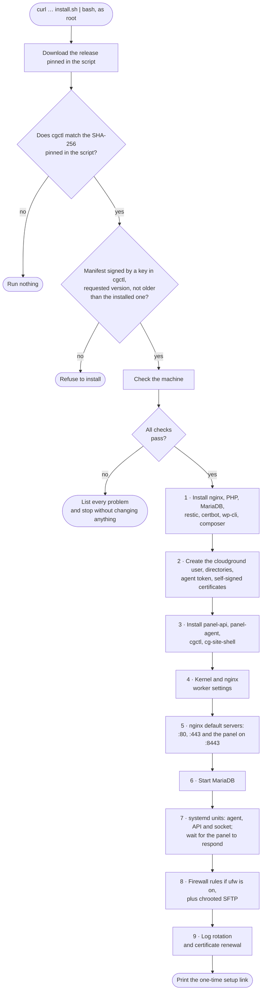

`install.sh` is a small bootstrap script. It downloads one release from GitHub, verifies it, and
hands off to `cgctl install`, which sets up a blank Ubuntu server and starts the panel. All output
from the programs it runs goes to `/var/log/cloudground-install.log`. The terminal shows only the
nine steps and how long each one took.

## Steps {#steps}

## Preflight check {#preflight}

Before any step runs, the installer checks everything and reports all problems at once, so you
can fix the machine in a single pass:

- Ubuntu 24.04 or 26.04 LTS on amd64;
- at least 900 MB of `MemTotal` (a 1 GB server reports a bit under 1024, and has to pass);
- at least 10 GB free on `/`;
- ports 80 and 443 free, because CloudGround's nginx needs them.

## Packages {#packages}

The PHP version depends on the OS release: 8.4 from the `ondrej/php` repository on Ubuntu 24.04,
and 8.5 from Ubuntu's own packages on 26.04. The distribution's PHP-FPM service is disabled,
because the agent starts a separate PHP-FPM process for each site.

Redis is not installed, since the sites' object cache uses APCu. A server upgraded from an earlier
version keeps its Redis, stopped.

The installer only installs packages that are missing. Re-running it does not upgrade packages
already present. That is left to the system's security updates or your own `apt upgrade`.

restic 0.19.1, wp-cli 2.12.0 and composer 2.10.3 are downloaded at exactly those versions, and
installed only if their SHA-256 matches the hash hard-coded in the installer.

## Binaries {#binaries}

The script pins one release and the SHA-256 of that release's `cgctl`. It downloads the release
from GitHub Releases, never from the host that served the script, and runs `cgctl` only if the
hash matches. `cgctl` then installs the binaries only if all of these are true:

- the `SHA256SUMS` manifest is signed by a release key compiled into `cgctl` (or, with
  `CLOUDGROUND_RELEASE_PUBKEY` set, by that key, which must also be one of the compiled-in keys);
- the manifest names the version the script asked for;
- the version is not older than the one already installed, or than the newest version the panel
  has updated itself to;
- every binary matches its hash in the manifest.

The systemd units ship inside `cgctl`, so once `cgctl` is verified, so are they.

## Trust model {#trust}

Once you run the genuine script, the host that served it has no further control. It holds neither
the files the script's hash pins nor the signing key. That host could still serve you a different
script, though, and a script can do anything. If you do not want to trust it, download the script
for a specific release and check it against the signed manifest, using the release key published
in these docs: [Verify the installer](/docs/server/verify-the-installer).

After installation, panel updates verify releases with the keys compiled into the installed
binaries.

## Server configuration choices {#server-choices}

- **Kernel and nginx.** Longer accept queues and a higher open-file limit, so a traffic spike does
  not drop connections before a worker can pick them up. `worker_connections` goes up to 4096. If
  nginx rejects the changed config, the installer restores the original.
- **Default servers.** On :80 and :443, an unknown hostname gets no response (`444`), except for
  certificate challenges. On :8443 the panel answers with its own self-signed certificate. That
  certificate stays even after you give the panel a domain, so you can always reach it by IP.
- **MariaDB.** The installer only starts it. The agent works out its configuration from the
  server's memory and CPU count.
- **Firewall.** The installer never turns ufw on. Many servers sit behind a provider firewall, and
  a script that enables ufw can lock you out. If ufw is already active, the installer opens the
  ports sshd listens on (as reported by `sshd -T`, or 22 if it reports none), plus 80, 443, 443/udp
  and 8443. If ufw is installed but inactive, nothing changes, and at the end the installer prints
  the commands to enable it with those ports open (see [Firewall](/docs/access/firewall#enable)).
- **SFTP.** Site system users (`cg-site-*`) get SFTP only, chrooted to the site directory. The
  [site shell](/docs/access/site-shell) uses a separate login.
- **Logs.** Site logs rotate daily or at 1 GB, and 14 rotations are kept.

## Re-running the installer {#rerun}

Each step inspects the machine first and changes only what differs. So running the installer for
the release that is already installed repairs the server: anything that still matches is left
alone, and services restart only when a file they read has changed. `cgctl doctor` runs the same
checks and reports differences without changing anything.

The installer for a different release refuses to run over an existing panel and points you to
`cgctl update --to <release>` instead. The installer takes no snapshot and cannot roll back; an
update does both (see [Update CloudGround](/docs/server/update-cloudground)).

## Next step {#next}

To try it on a server, follow the [Install CloudGround](/docs/tutorials/install) tutorial.
