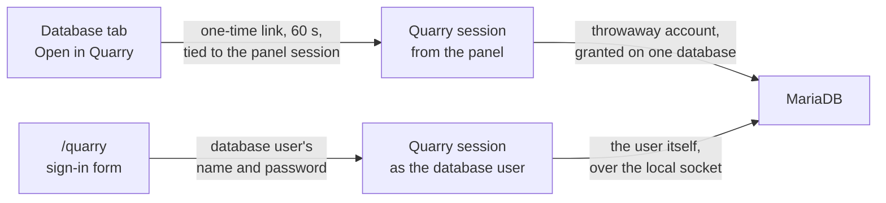

Quarry is CloudGround's database manager. It is served on the panel's
address at `/quarry`, but it is a separate service. A panel session or an
API token cannot reach any Quarry route, and a Quarry session cannot reach any panel route. Steps are in [Use Quarry](/docs/data/use-quarry).

## Two ways to sign in {#two-ways-in}

**From the panel.** **Open in Quarry** asks the panel for a link that works once, for 60 seconds,
and only alongside the panel session that requested it. The token sits after a `#` in the link,
and browsers never send that part to a server or include it in a `Referer`. The Quarry session
lasts as long as the panel session behind it, and on every request it checks that your account
still has access to the site. Its statements run as a throwaway database account with privileges
on that one database only. For a read-only panel account, that throwaway account can only read: it
sees the tables and their structure, and nothing else. API tokens cannot open Quarry. It needs a panel
session signed in from a browser.

**As a database user.** People without a panel account (a developer, an agency) can sign
in with the name and password of a database user the panel created. The agent connects to MariaDB
as that user over the server's local socket, and checks that the server authenticated it as
exactly that user. It never signs in as `root` (which needs no password over the socket on this
server) or as any of the server's own accounts. The password stays encrypted in the agent's memory
for the life of the session and is never written to disk, to the panel database or to a log.

## MariaDB enforces the limits {#mariadb-decides}

Quarry does not parse your SQL to guess what it is allowed to do. Every statement runs as an
account that MariaDB itself restricts. The throwaway account has privileges on one database, and a
read-only one gets only `SELECT, SHOW VIEW`. A database user who signs in has exactly the
privileges you granted it in the **Database** tab. If the account is not allowed to make a write,
the write fails with the server's own error. The same Quarry therefore suits someone
with a single table and an administrator: the boundary is the set of privileges, enforced by
the database server.

Each request opens its own connection and closes it when done. Nothing carries over between
requests: no transaction, no `LOCK TABLES`, no session variable.

## Sessions {#sessions}

Quarry sessions exist only in the panel's memory. A session ends after 30 minutes of inactivity or
12 hours after it started, when you sign out, or as soon as anything it depends on goes away: the
site, the panel session that opened it, or the database user's password. Restarting the panel ends
all sessions. Short lifetimes stop a forgotten browser tab from becoming a standing way into a
database.

## Simulate {#simulate}

Simulate runs a write inside a transaction and always rolls it back, to show you how many rows it
would change. Its promise is that *nothing is left behind*, and most of what it refuses is there to
keep that promise:

- **Statements that commit implicitly.** In MariaDB, `CREATE`, `ALTER`, `DROP`, `TRUNCATE`,
  `RENAME`, `LOCK` and similar statements end the open transaction, leaving nothing to roll back.
- **Non-InnoDB tables.** MyISAM, Aria and MEMORY tables do not support transactions, so changes to
  them stick whether or not you roll back.
- **Triggers, views, stored functions and loadable functions.** A trigger runs with its definer's
  privileges and can write anywhere. A view or function can reach tables the statement never names.
  Quarry cannot follow them, so it refuses them. It keeps an allowlist of built-in functions rather
  than a blocklist, so any trick nobody thought of is refused by default.
- **Functions that wait, lock or count.** `SLEEP`, `BENCHMARK` and the locking functions would tie
  up the connection. Sequence functions and `LAST_INSERT_ID` advance a counter that no rollback can
  reset.
- **Locking reads.** `FOR UPDATE` and similar clauses lock rows the statement does not change, and
  the live site may be waiting for those rows.
- **Alternative string parsing.** With `ANSI_QUOTES` or `NO_BACKSLASH_ESCAPES` in the session's
  `sql_mode`, the server interprets quotes and backslashes differently from Quarry's checks, so an
  identifier could pass as a string. Quarry checks every statement under each interpretation, and
  refuses sessions with those modes.

The site keeps serving traffic from the same tables while a simulation runs. A simulation waits
at most 5 seconds for a row the site has locked (the server default is 50), and the whole run is
capped at 60 seconds. While it waits, it holds the rows it has already locked, and the site would
be stuck waiting on them.

A rolled-back write still leaves one trace: an `AUTO_INCREMENT` counter, or a sequence that a
column takes its default from, may have advanced. The rows themselves are unchanged.

## Imports without a rollback point {#import}

When you open Quarry from the panel, a `.sql` import first backs up the database and restores it
if the import fails. Taking and restoring that copy needs privileges a database user may not have.
When a database user signs in directly, imports therefore have no rollback point. They run as that user,
one statement at a time. If a statement fails, the import stops there, and everything that ran
before it stays. The message says so.

## Files {#files}

Exports and uploads are stored in the site directory, under `shared/exports/` and
`shared/imports/`, which every session for the site shares. A database user who signs in directly
can see, download and import only the files created in their own session. Another user's export
might contain tables this user cannot read, and another user's upload, imported with this user's
privileges, could change data it was never meant to touch.

## Audit log {#audit}

Every write is recorded in the **Audit log** with the table and primary key, never the row
contents. Statements can contain secrets, so a statement is logged as its first word, its word
count and a fingerprint. Simulations are logged the same way as writes. Sign-ins and rejected
sign-ins are logged too.

## Next step {#next}

How repeated wrong passwords are slowed down without locking anyone out: [Sign-in
protection](/docs/explanation/sign-in-protection).
