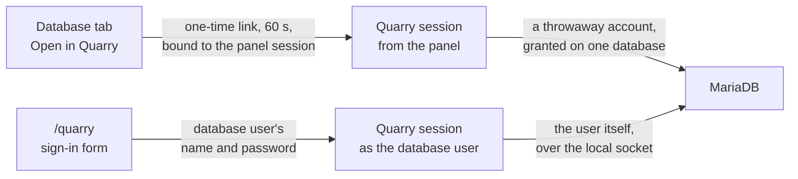

Quarry is CloudGround's database manager. It is built into the panel and served on its address at
`/quarry`, but it is a service of its own: a Quarry session is not a panel session. A panel session
or an API token reaches none of Quarry's routes, and a Quarry session reaches none of the panel's.
The steps are in [Use Quarry](/data/use-quarry).

## Two ways in {#two-ways-in}

**From the panel.** **Open in Quarry** asks the panel for a link that works once, for 60 seconds,
and only together with the panel session that asked for it. The link carries its token after a `#`,
which a browser never sends to a server nor puts in a `Referer`. Such a session lives as long as
the panel session behind it, and checks at every request that your account still reaches the site.
Its statements run as a throwaway database account granted on that one database only, and only to
read for a read-only panel account, which sees the tables and their structure and nothing else.
An API token cannot open Quarry: only a panel session signed in from a browser can.

**With a database user.** Someone who has no panel account, a developer or an agency, signs in with
the name and password of a database user the panel made. The agent connects to MariaDB as that user,
over the server's local socket, and checks that the server took it as exactly that user. It never
signs in as `root`, which on this server needs no password over the socket, nor as the server's own
accounts. The password stays in the agent's memory, encrypted, for the session's life: it is never
written to disk, to the panel's database or to a log.

## MariaDB decides {#mariadb-decides}

Quarry does not read your SQL to guess what it may do. Every statement runs as an account that
MariaDB itself limits: the throwaway account has privileges on one database, a read-only one only
`SELECT, SHOW VIEW`; a signed-in user has exactly the privileges you gave it in the **Database** tab.
A write the account may not make fails with the server's own error. That is why the same Quarry can
be handed to someone you trust with one table and to an administrator: the boundary is the
privileges, which the database server enforces, not the interface.

Each request opens its own connection and closes it at the end. Nothing lasts from one request to
the next: not a transaction, not a `LOCK TABLES`, not a session variable.

## Sessions {#sessions}

Quarry's sessions live in the panel's memory only. A session ends after 30 minutes unused and 12
hours after it began, on sign-out, and as soon as what it stands on goes: the site, the panel session
that opened it, or the database user's password. A restart of the panel ends them all. Short lives
keep an unattended tab from staying a way into a database.

## Simulate {#simulate}

Simulate runs a write in a transaction and always rolls it back, to show how many rows it would
change. The promise is *nothing stays*. Most of what it refuses is there to keep that promise:

- **Statements that commit by themselves.** In MariaDB, `CREATE`, `ALTER`, `DROP`, `TRUNCATE`,
  `RENAME`, `LOCK` and the like end the open transaction: there would be nothing left to roll back.
- **Tables that are not InnoDB.** MyISAM, Aria and MEMORY tables do not take part in transactions: a
  change to them stays, rollback or not.
- **Triggers, views, stored and loadable functions.** A trigger runs as its definer and can write
  anywhere; a view or a function can reach tables the statement does not name. Quarry cannot follow
  them, so it refuses them, and lists the built-in functions it accepts instead of the ones it
  refuses: a trick nobody thought of is refused by default.
- **Functions that wait, lock or count.** `SLEEP`, `BENCHMARK` and the lock functions would hold the
  connection; a sequence function or `LAST_INSERT_ID` moves a counter that no rollback moves back.
- **Locking reads.** `FOR UPDATE` and its kind lock rows the statement does not change, rows the live
  site may be waiting for.
- **Another way of reading strings.** With `ANSI_QUOTES` or `NO_BACKSLASH_ESCAPES` in the session's
  `sql_mode`, the server reads quotes and backslashes differently from the checks: a name could pass
  for a string. Quarry checks every statement under each reading, and refuses such a session.

The site keeps serving while a simulation runs, on the same tables. So a simulation waits at most 5
seconds for a row the site has locked (the server's default is 50), and the whole run has 60 seconds:
while it waits it holds the rows it has already locked, and the site would wait on them.

What a rolled-back write leaves anyway: an `AUTO_INCREMENT` counter, and a sequence a column takes its
default from, may have moved on. The rows do not change.

## Import without a rollback point {#import}

Opened from the panel, a `.sql` import first saves the database and puts it back if the import fails.
Making that copy and putting it back takes privileges a database user may not have, so a signed-in
user's import has no rollback point: it runs as the user, statement by statement, and a failure stops
where the server refused, with what ran before kept. The message says so.

## Files {#files}

Exports and uploads live in the site's folder, `shared/exports/` and `shared/imports/`, which every
session of the site shares. A signed-in database user sees, downloads and imports only the files it
made in its own session: another user's export may hold tables this one may not read, and another
user's upload, imported with this user's privileges, could change what it was never meant to.

## Audit {#audit}

Every write lands in the **Audit log**, with the table and the primary key, never the rows' contents;
a statement is recorded as its first word, its number of words and a fingerprint, because statements can carry
secrets. A simulation is recorded like a write. Sign-ins and refused sign-ins are recorded too.

## Next step {#next}

How repeated wrong passwords are slowed down without locking anyone out:
[sign-in protection](/explanation/sign-in-protection).
