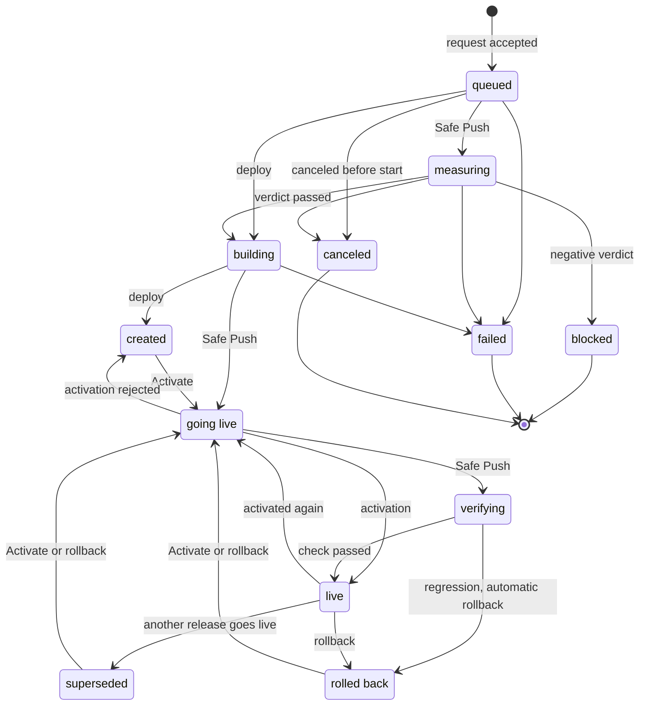

A site's code is never edited in place. Every deploy creates a new **release**, a
directory that is never modified afterwards. The site serves the release a single
symlink points to.

## Site directory layout {#layout}

```text
/srv/sites/<domain>/
├── current -> releases/<id>     the live release
├── releases/
│   ├── initial/                 the first release, created with the site
│   └── <id>/                    one per deploy
└── shared/                      config and uploaded files
```

nginx and PHP serve the site through `current`. Activating a release swaps that symlink for a new
one in a single atomic operation, so every request sees either the old release or the new one,
never a mix. PHP then reloads so the opcode cache serves the new code.

Every release symlinks `wp-config.php` and the uploaded files to the copies in `shared/`. A
rollback therefore changes the code but leaves the configuration, the database and the uploads alone.

`releases/` is owned by root, not by the site user. If the site user owned it, they could replace
a release with a symlink and make nginx serve any directory on the server.

Each release is identified by a ULID: 26 characters that begin with the creation timestamp, so
releases sort by age. After each activation, CloudGround keeps the live release, every newer
release and the 5 most recent older ones.

## Release states {#states}

The panel records every deploy and moves it through the states below. It rejects any transition
not in the diagram.



If an activation is rejected, the release returns to the state it started from: *created*,
*superseded*, *rolled back* or *live*. A site has at most one *live* release. When another release
goes live, the previous one becomes *superseded* in the same database write.

## Where a rollback goes {#rollback-target}

Before each activation, the panel asks the agent which release is live at that moment and records
it as the return point. A rollback with no explicit target goes back to that point. If the return
point is unknown, it goes to the most recent *superseded* release. The panel never lets the agent
pick "the release before the current one": that could be a release that was built but
never activated, and so never tested.

Only a release that has been live before can go live again. A release that Safe Push rolled back
because it made the site worse is marked as regressed and is never used as a rollback target.

## The server is the source of truth {#records-follow-the-server}

The site serves whatever `current` points to, regardless of what the panel's database says. After
a rejected activation or rollback, or after a restart that interrupted a deploy, the panel
re-reads `current` and brings its records into line:

- an activation interrupted before the switch goes back to *created*; one that had already
  switched `current` becomes *live*, and if it came from Safe Push it is verified now;
- a release built by a *failed* deploy is deleted from the server;
- if the site serves a different release from the one on record, that release gets the note *The
  site serves this release; the records said another was live*, and an alert appears.

If you cancel the post-Safe Push verification by hand, the release stays *live* with the note
*unverified* and an alert is raised. The panel does not mark a release as good without the
check.

## Next step {#next}

[Deploy a release](/docs/data/deploy-a-release).
