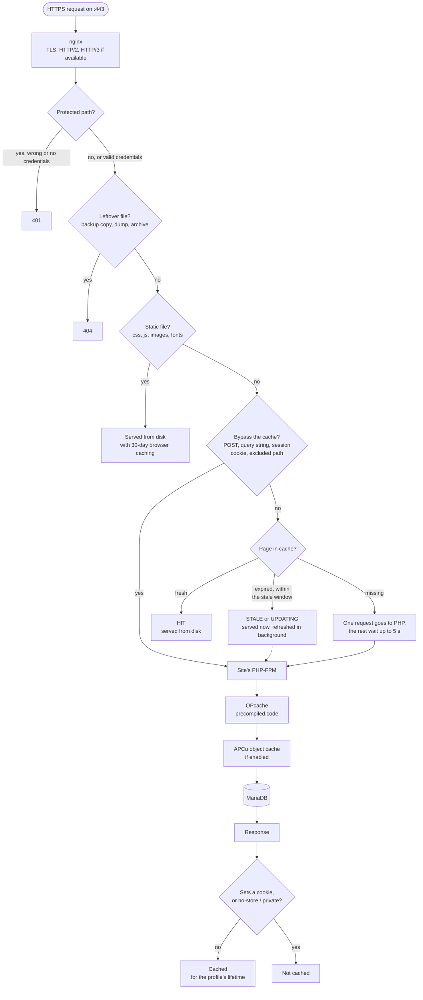

A page served from the cache never touches PHP: nginx reads it straight from disk. This page
traces a request to a PHP site (WordPress, WooCommerce, PHP, Laravel) and shows where it can stop
along the way. For exact values, see the [cache reference](/docs/reference/cache-behaviour).

## Request flow {#diagram}

## Before the cache {#before-the-cache}

*Since v0.2.0.* Two checks run before anything else:

- **Protected paths.** If the site requires a username and password on a path, nginx checks them
  at the level of the site's whole server block, before it decides where to route the request. So
  the check applies to static files, the cache and PHP alike, and a cached page on a protected path
  is never served without the password. See [Protected paths](/docs/access/protected-paths).
- **Leftover files.** Backup copies, SQL dumps and archives at the top level of the public
  directory return **404**. The full list is in [Site
  isolation](/docs/explanation/site-isolation#leftovers).

## nginx and the page cache {#page-cache}

The page cache is nginx's FastCGI cache, one per site, stored on disk under
`/var/cache/cloudground/<domain>`. The cache key is scheme, method, host and URI. When the page
cache is on, every response from PHP carries an `X-CloudGround-Cache` header with the cache status
nginx assigned to the request: `HIT`, `MISS`, `BYPASS`, `EXPIRED`, `STALE`, `UPDATING` or
`REVALIDATED`.

Three mechanisms keep the load on PHP down:

- **Request coalescing.** If a hundred visitors request the same expired page at the same moment,
  only one request reaches PHP. The rest wait up to 5 seconds for its response.
- **Stale-while-revalidate.** A page that has just expired is served immediately as it was, while
  nginx regenerates it in the background. The same happens when PHP returns an error or does not
  respond.
- **Tracking parameters.** A URL whose only parameters are things like `utm_*`, `fbclid` or `gclid`
  shares a cache entry with the same page without them. A marketing campaign does not send every
  click through to PHP.

## When the cache is bypassed {#bypass}

Each site type has its own bypass rules: a `POST`, a query string that contains more than tracking
parameters, a session cookie (the sign-in cookie for WordPress, the cart for WooCommerce), or a
path such as `/wp-admin` or `/checkout`. A request with an `Authorization` header always bypasses
the cache.

One rule applies to every type and matters most: **a response that sets a cookie is never
cached.** A page generated for a visitor with a session is never served to anyone else.

## PHP {#php}

When a request reaches PHP, the site's own PHP-FPM process handles it. That process holds only
this site's data:

- **OPcache** keeps compiled PHP code in memory. It checks for changed files at most every 60
  seconds, so after a release the panel reloads PHP to make the new code take effect at once.
- **Object cache** (WordPress, if you enable it) stores the results of repeated queries in APCu.
  It speeds up wp-admin, the cart and every page the page cache cannot serve.
- **MariaDB** runs on the same server, tuned to its memory and CPU count.

PHP compresses its own response, so the cache stores the page already compressed and serves it
without compressing it again.

## Other site types {#other-types}

A static site has no PHP: nginx serves files straight from disk. A reverse proxy forwards every
request to its upstream. Neither type has a page cache.

## Next step {#next}

To remove one page or a whole site from the cache, see [Purge the cache](/docs/data/purge-the-cache).
