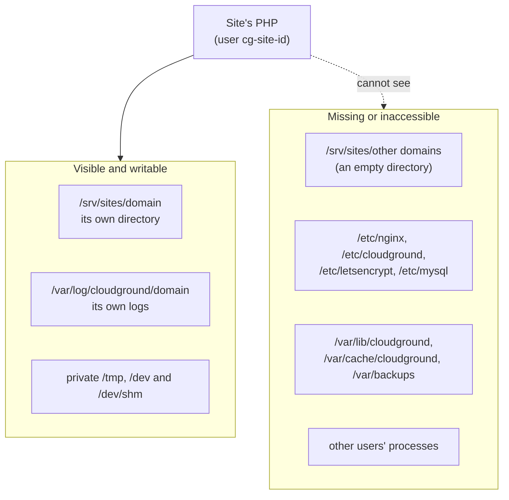

CloudGround treats every site on a server as an untrusted tenant. A compromised plugin on one site
must not be able to read another site's files, cache or database, or reach the panel. Isolation
is built in several layers, and each layer holds even if another one fails.

## One user per site {#one-user-per-site}

Each site has its own system user and group, `cg-site-<id>`, with no login shell. The site
directory, `/srv/sites/<domain>`, is owned by root, with the site's group and mode 0750, so other
sites cannot open it. nginx can get in because its user belongs to every site's group.

The directory skeleton (the top level, `releases/`, `.ssh/` and the `current` symlink) stays owned
by root. If the site owned it, it could replace a release with a symlink and point `current`, and
therefore the directory nginx serves, anywhere it liked. The server re-applies this ownership
before every release and every rollback.

A site's databases and database users belong to that site alone. The agent keeps its own record
of which name belongs to which site and refuses everything else. A database user only gets
privileges on its own site's databases, with a limit of 50 connections. `_` and `%` are escaped in
grants, because MariaDB would otherwise treat them as wildcards that also match other sites'
databases with similar names. Quarry runs as accounts restricted in the same way (see [How Quarry
works](/docs/explanation/quarry#mariadb-decides)).

## One PHP per site, sandboxed {#one-php-per-site}

Every site that runs PHP has its own PHP-FPM master process, running as the site user. There are
two reasons for this:

- OPcache and APCu live in the master's shared memory. If several sites shared a master, each
  could read and overwrite the others' cached objects.
- Those caches are sized per master, so one master per site lets you size them per site.

The master runs as a systemd service inside a sandbox. Here is what the site can see:

In detail:

- from the site's point of view, `/srv/sites` and `/var/log/cloudground` are empty in-memory
  directories with only its own site directory and log directory mounted inside;
- the rest of the system is read-only, and the configuration for the panel, nginx, certificates
  and the database, plus the panel state, page cache and backups, are inaccessible;
- other users' processes are hidden, and `/tmp` and `/dev` are private;
- `/dev/shm` is private temporary memory for the site, capped at 64 MiB, invisible to other sites
  and to the server (*since v0.2.0*; earlier versions used the server's shared one);
- the PHP master has its own IPC namespace, so the System V and POSIX shared memory, semaphores
  and message queues it uses cannot be reached from another site's PHP (*since v0.2.0*);
- no extra privileges: no capabilities, setuid binaries grant nothing, no new namespaces, and only
  Unix and IP sockets are allowed;
- PHP cannot run commands: `exec`, `passthru`, `shell_exec`, `system`, `proc_open` and `popen` are
  disabled.

The site's scheduled tasks, wp-cli commands and SSH shell run in the same sandbox, built from the
same list of settings, so they cannot drift apart. Every process belonging to the site lives in
its own systemd slice, `cg-site-<id>.slice`, so deleting the site stops all of them at once.

### Why not open_basedir {#why-not-open-basedir}

`open_basedir` is PHP policing the paths it opens. Here the boundary is the service's mount
namespace instead: anything the site must not see simply does not exist, for PHP and for any
program PHP might call. On the test server, `open_basedir` cut uncached requests per second by
28%. The panel leaves it off.

## Resource limits {#resource-limits}

*Since v0.2.0.* Each site's slice also has its own kernel-enforced limits: memory, CPU quota and
number of processes. If a site goes over its memory limit, one of its own processes is killed.
Other sites are unaffected, and the site's PHP keeps serving. A busy or broken site cannot starve
the others. For defaults, how to change them and how to read each site's usage, see [Resource
usage and limits](/docs/sites/resource-usage-and-limits).

## nginx and symlinks {#nginx-and-symlinks}

nginx can read every site, since it belongs to every site's group. That is why every site's vhost
sets `disable_symlinks if_not_owner`: nginx only follows a symlink if the link and its target have
the same owner. A symlink a site creates pointing at another site's directory is owned by the
site, but its target is not, so nginx refuses it. With a public directory (`public_root`), the
check starts at `current`, and the panel rejects any public directory whose path goes through a
symlink.

Custom routing that an administrator writes for a site cannot escape the site directory or proxy
to the server's own services. See [Edit the routing](/docs/sites/edit-routing).

## Leftover files in the public directory {#leftovers}

*Since v0.2.0.* Backup copies, editor files, dumps and archives left behind in the public directory
are never served. nginx returns **404** for:

- names ending in `.bak`, `.old`, `.orig`, `.save`, `.swp`, `.swo` or `~`;
- SQL dumps: `.sql`, `.sql.gz`, `.sql.bz2`, `.sql.xz`, `.sql.zst`, `.sql.zip`;
- copies of `wp-config.php` with a longer name, such as `wp-config.php.bak` (`wp-config.php`
  itself is passed to PHP as usual);
- archives at the top level of the public directory: `.tar`, `.tar.gz`, `.tgz`, `.tar.bz2`,
  `.tbz2`, `.tar.xz`, `.txz`, `.tar.zst`, `.zip`, `.7z`, `.rar`. Archives further down the tree,
  such as a plugin's downloadable file, are still served.

Matching is case-insensitive. The response is 404 rather than 403, so it does not confirm that the
file exists. A reverse proxy has no public directory, so nothing changes for it.

## Root operations inside the site directory {#root-inside-the-tree}

The panel's operations on a site's files (releases, restores, ownership fixes, copies for staging)
run with root privileges. Meanwhile, the site can rename anything it owns, or replace it with a
symlink, even while root is working on it. So every root operation inside a site directory opens
paths with `openat2` and `RESOLVE_BENEATH`. On every open, the kernel guarantees that the path
stays inside the directory. A symlink pointing outside is rejected, not followed. If `openat2` is
unavailable, the operation fails rather than falling back to a plain open.

The site's own symlinks (`current`, `wp-config.php`, `wp-content/uploads`) are relative, so they
resolve inside the directory.

## SFTP {#sftp}

With SFTP turned on, the site user signs in chrooted to the site directory, with only the internal
SFTP server and no shell. With SFTP turned off, the user belongs to a group the SSH server rejects,
even with a key.

*Since v0.2.0.* When access is set to SSH keys only, the user's password is locked and the user
joins a group for which the SSH server does not even offer password authentication. Only the key
works. The panel validates the SSH configuration with `sshd -t` before reloading it, and restores
the previous configuration if SSH rejects the new one. See [SFTP and SSH
keys](/docs/access/sftp-and-ssh-keys).

## Next step {#next}

[Site lifecycle](./site-lifecycle.mdx) explains how all of these pieces are created and removed.
