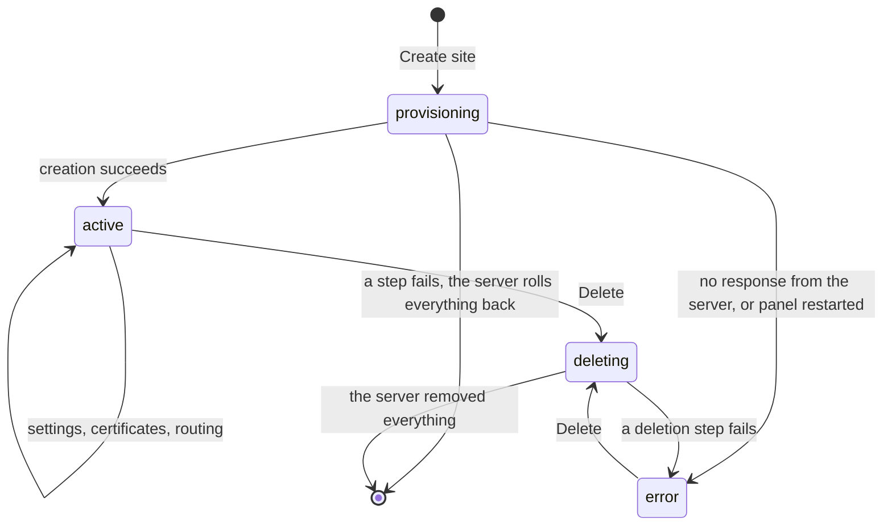
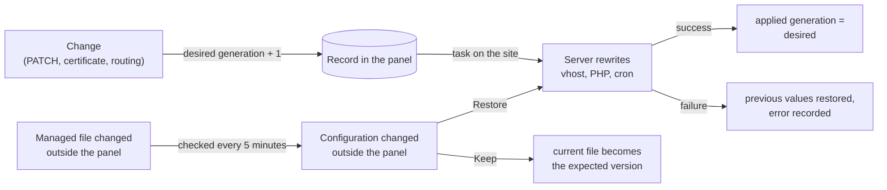

Every site exists in two places. The panel holds the **record**: the domain, the type and the
settings you asked for. The server holds **what actually runs**: the system user, the files, PHP
and the vhost. The lifecycle is how the two stay in agreement, even when something stops partway
through.

## States {#the-states}

**Provisioning.** The panel saves the record and queues a **Site creation** task. The server
creates, in order: the user, the directory, the database, the first release with the application,
the vhost and PHP, and for WordPress, the cron job. Every step has a matching undo. If a step
fails, the server undoes the completed steps in reverse order and the panel deletes the record, so
nothing is left half-built.

**Error instead of disappearing.** If the panel gets no response, because the server is not
answering or the task times out, it cannot know what was created. The site might exist and be
serving pages. So the panel keeps the record in the **error** state. Deleting the record would
leave a site that no page in the panel shows, and whose domain could never be created again. A
deletion cleans everything up.

**Active.** The site is serving. Every change goes through the desired configuration (see below).

**Deleting.** The server removes the routing first, so the site stops responding. Then it removes
the processes, PHP, scheduled tasks, database, certificates, user and finally the files. Each step
only removes what is still there, so running a deletion again succeeds. If one step fails, the
rest still run, and the site ends up in **error** with every reason listed.

If a panel restart interrupts a task, any site left in **provisioning** or **deleting** moves to
**error**. Canceling a creation before it starts deletes the record. Canceling a deletion before it
starts puts the site back in its previous state.

## Desired vs applied configuration {#desired-and-applied}

The record carries a **desired generation** number, which goes up with every configuration change,
and an **applied generation** number, which tracks how far the server has caught up.

- Every change is a task that holds the site's lock. Two changes to the same site never overlap,
  and each task re-reads the site as it is when the task starts.
- If the server cannot apply a change, the panel restores the previous values, but only for fields
  that no later change has already overwritten.
- The server does not rewrite a file whose content has not changed, and does not reload nginx if no
  nginx file changed. A PHP service whose rendered configuration is identical keeps running, with
  its caches intact.

## Managed files and outside changes {#managed-files-and-drift}

Every file the server writes for a site (the vhost, the cache zone, the PHP configuration and
service, the staging password, the WordPress connector) is recorded with its SHA-256 hash. Every 5
minutes, the panel compares those hashes against the files on disk. A file changed outside the
panel appears on the dashboard under **Configuration changed outside the panel**. The panel never
overwrites anything on its own. An administrator picks one of:

- **Restore**: the server rewrites the site's configuration to match the record;
- **Keep**: the file's current content becomes the expected version.

The same 5-minute check also re-renders site configuration after a panel upgrade or when the
number of sites changes, because the memory available for PHP workers is divided among all sites.

## Next step {#next}

[Site isolation](./site-isolation.mdx) explains what keeps one site separate from the others.
