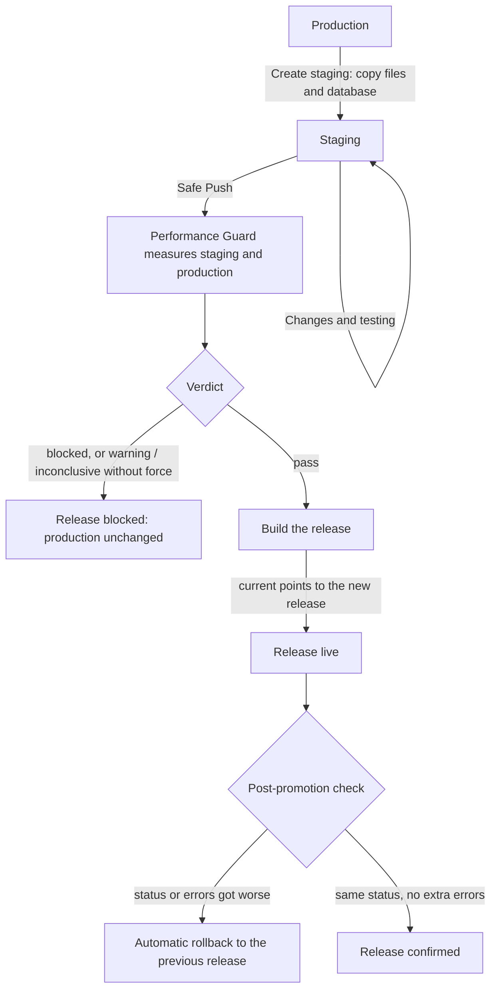

Staging is where you try out a change on a copy of production. Safe Push publishes that change
only if it does not make the site slower, heavier or broken. Performance Guard is the part that
does the measuring.

## Staging is a real site {#a-real-site}

The staging copy is a site like any other. It has its own system user, directory, database, PHP
pool and vhost, at `staging.<domain>`. When you create it, the panel:

- copies production's live release and uploaded files without following symlinks, so the copy
  cannot reach production's files;
- copies production's primary database into staging's. The site's other databases are not copied.
  The site's configuration (`wp-config.php`) does not use them, and a copy nothing in staging uses
  would only double the data. They stay with production only;
- on WordPress, points the configuration at staging's database and sets `WP_ENVIRONMENT_TYPE` =
  `staging`, a panel token different from production's, and fresh session keys. Someone who gets
  into staging cannot forge a sign-in to production;
- rewrites production URLs to staging URLs, including the JSON-escaped form (`\/\/domain`) that
  blocks use;
- asks search engines not to index it, and puts it behind a password.

## What gets published {#what-is-published}

**Code.** Safe Push builds a new production release either from staging's live release, or from
production's code with only the paths you pick taken from staging. Either way, `wp-config.php` and
the uploaded files stay production's. A release that comes from staging never carries staging's
credentials.

**Tables.** The primary database is published separately, table by table, from staging's database
into production's. Other databases are not involved. Some tables are never published, because in
production they hold live data that staging only has an old copy of:

- WordPress users (`*_users`, `*_usermeta`);
- on a store, also posts, post meta and comments (where orders and reviews live), and the tables
  for orders, sessions, customers, payment tokens, downloads, reserved stock and API keys.

A site counts as a store if its type is WooCommerce, if it uses the *commerce* profile, or if its
database contains tables from a manually installed WooCommerce. Before replacing any tables, the
panel takes a safety snapshot of production and verifies it. Afterwards, it restores production's
`blog_public` value, because staging's value would stop production from being indexed.

## How Safe Push works {#flow}

## How Performance Guard measures {#how-guard-measures}

Two sites on the same server never respond in exactly the same time. A backup, a cron job or a
noisy neighbour can change everything from one minute to the next. Performance Guard filters out
that noise in three ways.

**Paired measurements.** It runs 200 rounds per page. Each round requests the page from staging
and from production, in random order. Anything happening on the server affects both halves of the
same round, so the ratio between them reflects only the difference in code.

**Server-side PHP time.** Every request bypasses the page cache and carries a key that tells the
panel's plugin to append the render time, query count and memory use to the end of the page.
Performance Guard uses that time, not network time. On a site without the plugin it falls back to
the time measured by the client, and the report says so.

**Warm-up.** Before measuring, it sends each side at least twice as many requests as there are PHP
workers, so no measurement comes from a worker's first request with a cold opcode cache.

A page gets a **blocked** verdict if any of these is true:

- staging returns a different HTTP status from production in more than 10% of rounds;
- staging has more errors than production, above 1%;
- with 95% confidence, staging is more than 10% slower and the median difference exceeds 25 ms;
- staging runs at least 50% more queries (and at least 5 more), or uses at least 30% more memory
  (and at least 32 MiB more).

With less certainty, the verdict is **warning**. If the server is too noisy to tell, or there are
fewer than 20 usable pairs, the verdict is **inconclusive**. Safe Push publishes on *pass*. On
*warning* or *inconclusive* it publishes only if the request forces it. On *blocked* it never
publishes.

The threshold is 10% because staging and production are different sites, each with its own
database and caches, and the same code can differ by a few percent between them. The 200 rounds
are there so a 30% regression is still caught: in calibration runs it was almost always blocked,
while two identical versions were not. The cost is time. Each page needs 2 × 200 renders, which
takes about 30 seconds for a page PHP renders in 60 ms, and about two minutes at 300 ms.

## The post-promotion check {#after-promotion}

Right after the new release goes live, the cache is empty and PHP has just reloaded, so timings
are not comparable and are not judged. Instead, Performance Guard sends production 20 requests per
page and checks only status codes and errors. If any page returns a different status than before,
or more errors, the panel rolls back to the previous release and marks the new one as regressed,
so it can never go live again by mistake.

## Next step {#next}

For the steps in the panel, see [Staging and Safe Push](/docs/data/staging-and-safe-push).
