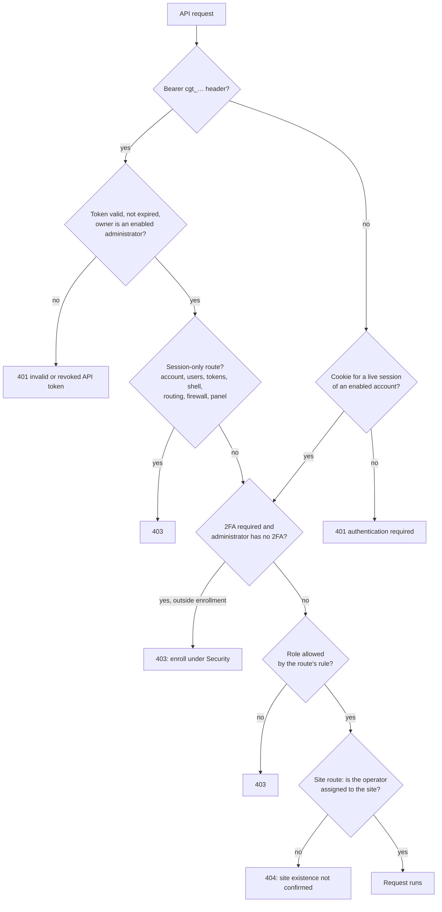

Every account has exactly one of three roles. To assign roles, see [Users and roles](/docs/access/users-and-roles).

| Role | API value | Scope |
| --- | --- | --- |
| **Administrator** | `admin` | The whole server. |
| **Operator** | `operator` | Assigned sites only, plus their staging copies. |
| **Read-only** | `readonly` | Can see the whole server but cannot change anything. |

## How a request is authorized {#how-the-panel-decides}

Every request goes through these checks in order. The first check that fails determines the
response.

A site outside an operator's scope returns **404**, not 403, so the panel does not reveal that it
exists.

## Route rules {#route-rules}

Every API route has one of these rules.

| Rule | Administrator | Operator | Read-only |
| --- | --- | --- | --- |
| open | yes | yes | yes |
| signed in | yes | yes, on assigned sites | yes |
| whole server (`global`) | yes | no | yes |
| manage (`manage`) | yes | yes, on assigned sites | no |
| administrator (`admin`) | yes | no | no |

## Permissions by role {#what-each-role-can-do}

*View* means read access only; *yes* means full access, including changes. For operators, every
permission applies to their assigned sites only.

| Area | Administrator | Operator | Read-only |
| --- | --- | --- | --- |
| Site list and details | yes | views own sites | views |
| Create and delete sites | yes | no | no |
| Site settings and PHP version | yes | yes | no |
| PHP extensions: list | yes | yes | yes |
| PHP extensions: install | yes | no | no |
| Site resources: usage | views | views own sites | views |
| Site resources: limits | yes | views | views |
| Site resources: usage alerts | yes | yes | views |
| Uptime check | yes | yes | views |
| Protected paths | yes | yes | views paths |
| Routing editor (Vhost) | yes | no | no |
| Server block list: view | yes | no | views |
| Server block list: block, unblock, always allowed addresses, settings | yes, from a session | no | no |
| Per-site rules (addresses, user agents, countries): view | yes | yes | views |
| Per-site rules: change | yes | yes | no |
| Known vulnerabilities for a site: view | yes | yes | views |
| Known vulnerabilities for a site: check now | yes | yes | no |
| Malware scan for a site: view | yes | yes | views |
| Malware scan for a site: scan now, quarantine | yes | yes | no |
| WordPress: two-factor sign-in and hardening (XML-RPC, editor, version, readme, sign-in URL) | yes | yes | no |
| Site certificates | yes | yes | views |
| Purge and warm the cache | yes | yes | views statistics |
| Releases: deploy, promote, roll back | yes | yes | views |
| Staging and Safe Push | yes | yes | no |
| Backups: run, restore test, restore | yes | yes | views |
| Backups: delete, retention, test the repository | yes | no | no |
| Files: list | yes | yes | views |
| Files: read, write, upload, download | yes | yes | no |
| Databases and database users: create, delete, privileges, passwords | yes | yes | views |
| Quarry from the panel: tables and structure | yes | yes | yes |
| Quarry from the panel: rows, SQL editor, search, export, import | yes | yes | no |
| Quarry from the panel: writes in the SQL editor | yes, with **Allow writes** | yes, with **Allow writes** | no |
| WordPress: wp-admin sign-in, updates, object cache | yes | yes | views plugins |
| SFTP access and "SFTP only" keys | yes | yes | views keys |
| Site shell and "shell" keys | yes, from a session | no | no |
| Scheduled tasks | yes | yes | views, with commands truncated |
| Import a migration | yes | yes, but cannot change the expansion limit | no |
| Site logs | yes | yes | yes |
| Functions: list, code, runs, addresses | yes | no | views |
| Functions: create, change, deploy, test, roll back, delete, tokens, domains, functions domain | yes | no | no |
| Server logs, services, firewall, status and metrics | yes | no | views |
| Restart services, firewall rules | yes | no | no |
| Turn on the firewall | yes, from a session | no | no |
| Changes made outside the panel | yes | no | views |
| Audit log | views | no | views |
| Panel settings | yes | no | views (secrets masked) |
| Panel domain, panel updates | yes | no | no |
| Alerts | views, dismisses | views own, dismisses | views |
| Background tasks | views, cancels | views own, cancels those on own sites | views |
| Users | yes, from a session | no | views |
| API tokens | yes, from a session | no | no |
| Own account: password, 2FA, sessions, profile | yes | yes | yes |

*Since v0.2.0.* The rows for PHP extensions, [site resources](/docs/sites/resource-usage-and-limits),
the [uptime check](/docs/sites/uptime-monitoring), [protected paths](/docs/access/protected-paths)
and turning on the firewall, plus truncated scheduled task commands for read-only accounts.

*Since v0.3.0.* The rows for the block list, per-site rules, vulnerabilities, the malware scan, and
WordPress two-factor sign-in and hardening. **Check WordPress sites for known vulnerabilities** and
**Scan the sites’ files for malware every week** are panel settings, so only an administrator can
change them. Block list changes are session-only routes, like the firewall: an API token gets
**403**, and `cgctl blocklist` also signs in with an email and password.

*Since v0.9.0.* The rows for [functions](/docs/functions): a server-wide resource, so the rule is `global` for reading and `admin` for every change. An operator sees no functions, and a read-only account sees them but cannot run a test, which goes through the function itself.

## API tokens {#api-tokens}

An API token has no permissions of its own. It acts as the administrator who created it, for as
long as that owner is an enabled administrator, and is subject to the same two-step verification
rule. There are no tokens scoped to a single area. Only administrators can create tokens.

A token can never reach session-only routes: your own account (password, 2FA, sessions, profile),
users, tokens, the site shell, the routing editor, firewall rules and turning the firewall on, and
the panel's certificate and updates. It also cannot add a "shell" key. All of these return **403**.
A token cannot open Quarry either.

A database user signed in to Quarry with its own password has no panel role. Its MariaDB privileges
decide what it can do (see [How Quarry works](/docs/explanation/quarry#mariadb-decides)).

The panel revokes all of an account's tokens when its password is changed or reset, when two-step
verification is turned off, when the account is disabled, demoted or deleted, and when you run
`panel-api recover-admin`.

## Connector token {#connector-token}

Each WordPress site has a connector token, separate from user accounts. The site's plugin uses it
only to ask the panel to purge the site's pages from the cache. It grants access to nothing else.

## Next step {#next}

Create accounts with the right role: see [Users and roles](/docs/access/users-and-roles).
